# AIGDOS Purpose and Full Capability Guide

[中文](AIGDOS_CAPABILITIES.md) | **English**

Applies to **v4.98-beta.1**, released November 18, 2026. This guide is based on the contents of the published ZIP. It explains the system's purpose and operation, all 53 public skills in the production pack, bundled tools, and advanced module documentation.

[Home](README.en.md) · [Quick start](V498_BETA1_QUICKSTART.en.md) · [Release notes](V498_BETA1_RELEASE_NOTES.en.md) · [Build identity and validation summary](V498_BETA1_BUILD_RECEIPT.json)

Navigation: [Purpose and responsibilities](#1-what-it-is-for) · [Package and evidence levels](#2-package-contents-and-evidence-levels) · [Capability map](#3-from-idea-to-delivery) · [Suggested workflow](#4-suggested-workflow) · [Commands](#5-command-reference) · [Beta limits](#6-beta-limits-and-evidence) · [53 skills](#7-all-53-public-production-skills) · [Package documentation](#8-further-reading-inside-the-package)

## 1. What it is for

AIGDOS (AI Game Dev OS) organizes AI-assisted game development into a process that can be continued and checked: requirements have sources, designs have versions, tasks have states, changes have boundaries, results have source code and execution evidence, and delivery has independent review and human decisions.

It is intended to help with:

- **Turning an idea into an implementable design**: develop the concept, gameplay, balance, UI, content, and asset requirements separately, then assemble a game design document (GDD) and specifications that can guide production.
- **Developing a game over time**: retain tasks, design facts, changes, handoffs, and evidence-linked experience across sessions, reducing the work of re-explaining the project or locating the correct version.
- **Delivering a real feature**: define a bounded Godot feature slice, organize code, scenes, data, and art bindings, retain checks and the implementation commit, and hand the result to an independent reviewer.
- **Understanding completion**: use Console and structured evidence to distinguish work in progress, completion claimed by an executor, independent review passed, and human acceptance.

These are intended uses, not promises about development speed or quality gains. Overall professional efficacy has not passed acceptance for this version.

### Responsibilities of people, the AI host, and AIGDOS

| Participant | Responsibility |
| --- | --- |
| Human / project owner | Set goals and constraints, choose design directions, authorize project operations, assess visuals and gameplay, and decide human acceptance and publication |
| AI host / coding assistant | Read project instructions, use models for analysis/design/coding, select actual tools, supply executor and reviewer identities, and perform authorized operations |
| AIGDOS | Supply role and skill contracts, context organization, task and handoff entry points, artifact formats, validators, evidence and memory tools, and project Console |
| Godot, Git, image tools, and other external tools | Run the engine, manage source code, generate or process images, export builds, and perform external checks |

Hosts can integrate using the supplied adapter materials. The package retains configuration or reading sets for Codex, Cursor, Claude Code, and WorkBuddy. **The presence of adapter materials does not mean every host combination was validated in this Beta.** AIGDOS does not provide a model subscription, embedded large language model, autonomous agent scheduler, or filesystem permission isolation.

## 2. Package contents and evidence levels

One ZIP contains the following; no older package needs to be downloaded separately:

```text
DevOS-v4.98-beta-integration/
  dev_os.py                    # Current candidate command entry
  candidate_manifest.json      # File inventory, provenance, and SHA-256
  AI_Game_Dev_OS_v4.97/         # Runtime and base capabilities, original bytes
  AI_Game_Dev_OS_v4.98/         # Current additions, production pack, art tools
  tools/                       # Candidate integration, Console, and other tools
```

`AI_Game_Dev_OS_v4.98/` alone is an increment and does not contain a complete task runtime. Use the complete extracted package and `dev_os.py`. Historical documents, `draft` labels, and case identities retain their original meaning. Public distribution of the Beta does not automatically promote every component to a qualified product.

This guide distinguishes four evidence levels. More than one can apply to a module:

| Level | Meaning | What it does not establish |
| --- | --- | --- |
| **Tested in this integration** | The same build has isolated new-project and related GUI/export evidence summarized in the build receipt | Success for arbitrary projects, all platforms, or every skill |
| **Bundled executable tool** | Scripts, input formats, checks, or adapters are included and callable under their dependencies and prerequisites | One command replaces every domain judgment or human review |
| **Host execution contract** | Working methods, role responsibilities, permitted write scopes, outputs, and checks are defined | Skill JSON starts models, creates agents, or obtains permissions by itself |
| **Bounded development / inherited capability** | Limited implementations, experiments, or historical validation are retained under each module's original contract | Full production qualification, migration qualification, or general disaster recovery |

## 3. From idea to delivery

See the [architecture diagram on the home page](README.en.md#dev-os-architecture) for the overall components. The delivery flow below shows responsibilities, not an automatic scheduler that completes the entire chain.

### Delivery flow



[Open SVG](docs/diagrams/delivery-flow.en.svg) · [Mermaid source](docs/diagrams/delivery-flow.en.mmd)

This is a delivery-order overview: missing or failed checks do not automatically permit a completion claim, and open handoffs block closure. `run-request` stops at `CLAIMED_DONE`; independent review, task closure, and human acceptance must still be performed separately. Runtime tasks and Whiteboard acceptance are different state records. Release qualification is a separate decision.

| Area | Work and outputs | Entry points and conditions |
| --- | --- | --- |
| GDD and CoFlow | Turn intent into staged plans and context packets; organize concept, world, mechanics, modes, balance, UI, resources, and independent design review | `run_gdd_orchestrator.py` and associated skills; the CLI organizes work and the host authors content |
| Specialist design | Design core loops, system depth, modes, economies, balance, levels, content, progression, rewards, and gameplay readability | Documents and structured contracts; professional judgment and gameplay validation remain necessary |
| Living documents and changes | Maintain facts, terminology, module dependencies, GDD indexes, chunk coverage, audits, change deltas, approved merges, and production-spec patches | Link design sources and approvals; consistency checks cannot discover every undeclared fact |
| Tasks and independent review | Create/resume tasks, record progress, claim completion, hand off, and review independently against real Git commits | Current successor entries use the fixed State Service; they do not introduce a second authority for task state |
| Code, scenes, and data | Constrained Worker writes; Godot feature slices; scene/resource writes and load checks; full RawData chains and GameString repairs | The host supplies implementations and actual project tool bindings; all writers must follow the cooperative locking protocol |
| Art, UI, and assets | Concepts, scenes, atmosphere, bounded local edits, transparent decorations, layer previews, UI binding, and visual acceptance records | External generation, local processing, and independent review; assets still need acceptance for their intended use |
| QA and development builds | Focused behavior checks, evidence bundles, export preparation, PCK byte checks, formal development builds, and delivery records | The current new-project example and bounded macOS formal development chain have integration evidence |
| Project Console | Three tabs for tasks, relationships, scenes/scripts; GDD, balance-table, and art locations; project phase | Local browser; static views and record projections do not change acceptance authority |
| Memory and retrieval | External experience capture, immutable revisions, quarantine, queries, and candidate-index checks | Explicit inputs and evidence; no automatic access to all chats or private projects |
| Architecture and traceability | Shared Truth links design, implementation, and Git evidence; Architecture Baseline describes modules, scenes, resources, and design-to-code relationships | Inherited schemas, validators, and artifact protocols; callers must supply truthful and complete relationships |
| Controlled refactoring and run records | Small-refactor proposals, approved handoffs, before/after comparisons, regressions; Agent Harness run plans, execution traces, and handoffs | Host execution with explicit scope and evidence; a plan does not itself authorize changes |
| Observation and resources | Read audits, context references, task timing, explicit model usage, and bounded capacity/database/recovery diagnostics | Adopt each selected module explicitly; no automatic collection of all work or automatic gate passage |

### Design and GDD workflows

GDD tools can establish a plan from game intent, prepare a stage's context, and validate stage outputs and review relationships. Work can use `brief`, `standard`, `production`, or `exhaustive` depth profiles. Section 7 lists the eight CoFlow stage skills.

The host must read the method and direct upstream material, produce documents and structured evidence, and obtain an independent review verdict. Lexical, structural, reference, and schema diagnostics can reveal omissions; they do not prove that a design is fun or professionally sound. The current GDD consumer also requires consistent audit evidence, so a machine report alone cannot approve a design.

Package entries: `AI_Game_Dev_OS_v4.98/CF498.md` and `AI_Game_Dev_OS_v4.98/pack_layer/scripts/delivery/run_gdd_orchestrator.py`. Existing runs remain bound to their original methods and sources. Rewriting historical bindings cannot turn an old result into validation of a new method.

### Art capabilities

Art Pipeline Kit brings intended use, structure, permitted changes, provenance, generation budgets, original outputs, processing records, visual review, and closeout into one workflow. New tasks use `tools/workflow_v2.py`; existing-layer operations use `tools/asset_layers.py`. Both paths are relative to `AI_Game_Dev_OS_v4.98/pack_layer/art_pipeline_kit/`.

- Scenes, atmosphere, and concepts: generate candidates from briefs, perform constrained edits, normalize outputs, and prepare review packets. The host's actual image tools perform generation.
- Local edits and asset acceptance: separate editing from review, judging the intended display size, silhouette, structure, materials, lighting, and approved use.
- Reusable transparent decorations: use a standalone decoration workflow, with explicit measurement requirements for precise placement and material fit when the task calls for them.
- Existing asset layers: extract using supplied masks, toggle layers in their original order, preview composites, and reuse layers over other backgrounds. There is no automatic semantic segmentation or reconstruction of hidden background content.
- Runtime UI binding: connect accepted assets to actual project scenes/scripts and supply check evidence. Accepting an image alone does not establish its in-game result.

The package preserves the Kit's own 0.2.5 identity and the identity of its additions. Including layer tools in this Beta does not rewrite the older fixed Kit's release status. Strict map topology, multi-view consistency, and reliable one-generation delivery are not guaranteed. Character-layer generation remains `experimental / not enabled`; animation, rigging, and replacement of production game assets use their separate specialist workflows.

### Tasks, source writes, and independent review

`run-request` takes a caller-authored request and source, creates a new project outside the package, runs real Godot checks, creates local source commits, and hands off the result. It ends at `CLAIMED_DONE`. Current task operations use `tools/dev_os_candidate/task_runtime.py`; source writes use the `production_worker.py` successor. The fixed State Service retains authority over task state and history.

Creators, executors, source writers, progress/work contributors, and completion claimants cannot independently approve the same task through this entry. The host must provide trustworthy, distinct identities. These records do not authenticate against a malicious caller bypassing the entry through raw APIs.

Replacing existing source uses `isolated_cooperative.v1`: comparison and publication occur under the same project lock. Its guarantee requires every writer in the isolated workspace to cooperate. Direct file editors and legacy writers are outside that conflict-protection guarantee.

An independent reviewer can start by checking the queue:

```sh
python3 -B dev_os.py review \
  --project "/absolute/new-game-run/project" \
  --actor candidate-independent-review --action queue
```

Then follow the packaged README's JSON input requirements for `accept-handoff`, `complete-handoff`, and finally `pass` or `reject`, supplying the actual task, implementation commit, and evidence references. An open handoff still blocks closure, and review actions cannot also edit work products. Human acceptance in Whiteboard is recorded separately. Historical tasks without complete participant records cannot be forced into independent approval through this entry.

### QA, exports, and delivery

“Formal development build” means a development delivery process with required checks. It does not mean a game is qualified for a store release.

| Layer | Entry / artifact | What it establishes |
| --- | --- | --- |
| Installation check | `dev_os.py doctor` | Package inventory, dependencies, fixed provider, runtime import origins, and related checks |
| Feature execution | `dev_os.py run-request`, focused QA | Import and behavior assertions for the specified source/environment, with a review handoff still pending |
| Export preparation | `dev_os.py prepare-export` | Select source files explicitly by SHA-256, copy them into a new workspace, and bind a Godot 4.4 macOS template and debug preset |
| Raw PCK byte verification | `dev_os.py verify-export` | Identity of declared original PNG and GDScript/JSON bytes in a standalone, unencrypted PCK v2 |
| Formal development build | Base `scripts/development/run_godot_development_build.py` | Clean pinned Git source, matching double exports, signature, recovery, delivery, and launch gates, as recorded by the actual receipt |
| Final confirmation | Independent review plus human acceptance in Whiteboard | Acceptance of the specific implementation, observed behavior, and stated criteria |

`prepare-export` does not invoke the engine or Git or modify the source project. Supported raw formats and importer modes are limited. `verify-export` does not prove scene-binary equivalence, rendering, gameplay, signatures, or GUI behavior. A PCK PASS cannot override an engine error. Exported apps still need to be run and observed. Local ad-hoc signature verification is not Developer ID notarization for download users.

### Console and project visualization

The packaged `tools/dev_os_console/README.md` describes three tabs:

- **Whiteboard**: project tasks, acceptance criteria, evidence, next steps, and connected runtime tasks, retaining historical-source labels.
- **Runtime Graph**: recorded relationships between executors, dependencies, handoffs, issues, and gate references.
- **Game Map**: a hierarchy starting from the Godot main scene and autoloads, with Scratch-style views of events, conditions, actions, and recorded signal calls, plus file/line references you can copy.

Game Map uses Godot text scenes and static GDScript declarations. Limits around dynamic objects, read limits, and unknown project phases are reported explicitly. Console listens only on local `127.0.0.1`. To open or refresh it manually:

```sh
python3 -B tools/dev_os_console/session_complete.py \
  --project-root "/absolute/new-game-run/project"
```

New-project instructions ask the main model to call this entry at the end of normal replies. The host must actually load the instructions and have local tool permissions; forced interruption can prevent closeout. Custom initialization can use `dev_os.py model-instructions --project ...` to print the corresponding text.

### Memory, observation, and advanced runtime capabilities

**External long-term memory (LTM)**: `dev_os.py ltm` supports `capture`, `capture-sprint`, and `consult`, with JSON requests on stdin. Project/domain/record identities and content use full UTF-8 SHA-256 keys. Revisions preserve history; identical retries reuse checked bytes. Captures missing evidence or approval go into quarantine. Queries exclude quarantine and do not guess which revision has been accepted. The fixed package corpus is not changed, and old memory is not automatically migrated.

**Candidate indexes and retrieval**: tools cover public-memory index health, explicit snapshot candidate creation, read-only trial queries, query rewriting, source excerpts, and evaluation. Candidate search uses the selected snapshot and SQLite full-text rules. It is not general semantic search across all projects and does not automatically activate an index.

**Observation and measurement**: read audits, time spent in task states, lifecycle events, recovery actions, delivery checks, CoFlow check records, explicit model usage, and selected production-observation populations. Missing or unrun observations remain unknown. Time in a state is not human labor time, and importing token records is not automatic billing integration. P0/P1 production-measurement readers were validated only with synthetic inputs; their results cannot substantiate real efficiency claims.

**Inherited production composition**: the fixed v4.97 base includes Production Cell, multi-lane DAG coordination, isolated workspaces and controlled integration, Production Assembly, quality contracts, Pack Registry/reuse previews, Evidence Continuity, Project Memory, permission-aware retrieval, and an optional local Team Memory provider that is off by default. They require exact project bindings and their original gates, retaining their original `draft` or bounded-validation status. This Beta does not qualify them across all projects.

**OS governance and extension foundations**: the fixed base also retains the control plane, Orchestrator, capability protocols, runtime database, configuration/mount/Hub routing, and self-evolution governance entries. The FixOps problem-handling foundation still includes docs-only scope. Formal adoption of rules or experience requires the original promotion process and approval; this does not mean the system modifies and upgrades itself automatically. See the base `MODULES_AND_INVOCATION.md` for the module map.

**Capacity, databases, and recovery**: the package includes evidence capture, closed-batch shared recovery, streaming recovery, execution capacity, database workload/interruption recovery/consumer rechecks, read-only audits, and explicit retention/retirement tools. Each has its own pinned sources, resource budgets, consumers, evidence, and authorization conditions. They are not an automatic cleaner or a complete filesystem backup. Inclusion of `REFUSAL_RECOVERY.md` does not lift **CAP16 blocked**; OBS65 also remains blocked.

## 4. Suggested workflow

1. **Required: download and verify.** Prepare the environment using the [getting-started instructions](V498_BETA1_RELEASE_NOTES.en.md), then run `doctor --profile godot`. Resolve reported dependency or package-identity failures first.
2. **Useful: run the new-project example first.** Choose a new directory outside the package, read `charge_meter.json`, run `run-request`, and inspect the project, evidence, and pending-review status.
3. **Required: define inputs for your own feature.** Give the host your game intent, current design, allowed changes, and acceptance criteria. Prepare requests, source, or other artifacts using the relevant skill. The example is not an arbitrary natural-language game generation interface.
4. **Required: execute and review the actual result.** Retain failed attempts. Run the appropriate tests, exports, or GUI observations for the current implementation, then complete independent review and human acceptance.
5. **Useful: keep Console and design indexes in use.** Check tasks, dependencies, and design changes as work continues, avoiding decisions based on stale state.
6. **Optional: adopt advanced modules as needed.** Prepare dependencies and inputs separately for art, external memory, formal development exports, production measurement, and capacity tools. A first trial does not require every module.

## 5. Command reference

Run these from the extracted package root. For parameters, JSON formats, and prerequisites, use the packaged `tools/dev_os_candidate/README.md` and each command's `--help`.

| Command | Purpose |
| --- | --- |
| `python3 -B dev_os.py doctor --profile godot` | Check selected dependencies and package identity; `core`, `art`, and `all` are also available |
| `python3 -B dev_os.py capabilities` | Check agreement between the 53 public skills, routing matrix, workflow owners, and definitions; report source paths and hashes |
| `python3 -B dev_os.py capabilities --skill SKILL_ID` | Inspect a skill's owner, write scope, and validation templates without executing the skill |
| `python3 -B dev_os.py run-request --request REQUEST --workspace NEW_DIR` | Execute a caller-authored request and produce evidence and a review handoff in a new isolated project |
| `python3 -B dev_os.py task --project PROJECT --action ACTION` | `create` / `resume` / `progress` / `claim` / `handoff`, with operation payloads on JSON stdin |
| `python3 -B dev_os.py review --project PROJECT --actor ACTOR --action ACTION` | Inspect the queue, process handoffs, and issue independent `pass` / `reject` results |
| `python3 -B dev_os.py model-instructions --project PROJECT` | Print Console instructions bound to a project without modifying that project |
| `python3 -B dev_os.py ltm --root EXTERNAL_CORPUS --action ACTION` | Capture or consult external memory using JSON stdin |
| `python3 -B dev_os.py prepare-export --request REQUEST --workspace NEW_DIR --template TEMPLATE` | Prepare a new export project explicitly bound to selected source and template |
| `python3 -B dev_os.py verify-export --project PROJECT --pck PCK` | Verify declared original-file byte identity in the actual PCK |

New-project outputs must use new directories outside the package, with existing parents. Fixed packages, existing projects, and historical runs are not automatically upgraded. The included RandomHeroes adoption entry covers only its specified archives and contract; it is not a general migration tool.

## 6. Beta limits and evidence

This version reuses acceptance of the same build and original ZIP. See the [build receipt](V498_BETA1_BUILD_RECEIPT.json) for tested new-project execution, formal development exports, related independent review, three Console tabs, and Whiteboard save/restart readback. Adding this documentation did not rerun product tests or expand acceptance scope.

- Tested environment: macOS, Python 3.13.2, Godot `4.4.stable.official.4c311cbee`, and Git 2.50.1. A full macOS minor-version/hardware matrix, Windows, Linux, and cross-machine reproducibility have not been qualified.
- The declared Python minimum is 3.10. Dependencies are pinned to jsonschema 4.26.0 and PyYAML 6.0.3. Art may additionally need Pillow/NumPy, Node.js, and ffmpeg/ffprobe; structural transfer needs SciPy. Different art workflows do not all require the same tools.
- The fixed base retains one historical script syntax exception, recorded as `PASS_WITH_FROZEN_EXCEPTIONS`. Use `tools/dev_os_candidate/profile_boot_readset.py` for profile reading sets.
- `doctor`, the skill catalog, schema PASS, PCK PASS, independent review, and human acceptance establish different things and cannot replace one another.
- Generation, authoring, role routing, and review still depend on correct host execution. Role names are not processes, permissions, or strong identity authentication.
- This Beta does not establish overall professional efficacy, general upgrades of existing projects, general backup/recovery, or long-term production reliability of every module.
- **OBS65 and CAP16 remain blocked. Public Beta distribution does not constitute full formal-release qualification.**

## 7. All 53 public production skills

This catalog covers every public skill in the current v4.98 `end_to_end_production_pack`, without counting compatibility mirrors twice. OS tools and other inherited packs are described elsewhere in this guide.

Every row is a **host execution contract**. Names describe task purposes, and owners come from the routing matrix. Read the skill definition for exact write scopes, required inputs, outputs, failure conditions, and validation templates. The lifecycle in `capability_pack.json` remains `draft`.

Shared package path: `AI_Game_Dev_OS_v4.98/pack_layer/packs/game_system_packs/end_to_end_production/`. Definitions are in `skills/<skill_id>.json`; routing authority is `references/cross_pack_routing_matrix.json`; the workflow view is `references/end_to_end_delivery_workflow.json`. Definitions of `art_asset_preparer` and `design_spec_author` are inherited from the corresponding fixed v4.97 packs. `capabilities` reports their exact paths.

### CoFlow stage design

| Skill ID | Purpose | Owner role |
| --- | --- | --- |
| `coflow_concept_draft_skill` | Concept and experience design | `gdd_creative_director` |
| `coflow_world_draft_skill` | World rules and playable narrative | `content_progression_designer` |
| `coflow_mechanics_draft_skill` | Mechanics, interaction, and system depth | `gameplay_systems_designer` |
| `coflow_modes_draft_skill` | Modes, control configurations, and session lifecycle | `gameplay_systems_designer` |
| `coflow_numeric_draft_skill` | Numeric models, economy, and sensitivity | `balance_economy_designer` |
| `coflow_ui_draft_skill` | Early UI, information architecture, states, and interaction readability | `gdd_uiux_bridge_author` |
| `coflow_resources_draft_skill` | Asset requirements, specifications, inventory, and production scope | `coflow_resource_planner` |
| `coflow_review_draft_skill` | Independent design and production-feasibility review | `gdd_review_steward` |

### GDD planning and authoring

| Skill ID | Purpose | Owner role |
| --- | --- | --- |
| `coflow_gdd_synthesis_skill` | Turn CoFlow decisions into GDD and specification handoffs | `gdd_production_author` |
| `coflow_style_longform_gdd_authoring_skill` | Author CoFlow-style longform GDD drafts | `gdd_creative_director` |
| `gdd_orchestrator_skill` | Organize GDD plans, context, and stage validation | `gdd_production_author` |
| `gdd_depth_profile_skill` | Define GDD depth profiles and deliverable requirements | `gdd_production_author` |
| `gdd_module_generation_plan_skill` | Plan module generation order and scope from intent | `gdd_production_author` |
| `gdd_creative_expansion_skill` | Expand initial intent into a creative draft | `gdd_production_author` |
| `gdd_creative_direction_selection_skill` | Compare and select creative directions | `gdd_creative_director` |
| `game_research_synthesis_skill` | Synthesize research evidence for design decisions | `game_researcher` |
| `gdd_module_authoring_skill` | Author GDD modules against production requirements | `gdd_module_author` |

### Gameplay, balance, and content design

| Skill ID | Purpose | Owner role |
| --- | --- | --- |
| `core_gameplay_loop_design_skill` | Design core gameplay loops | `gameplay_systems_designer` |
| `systems_depth_design_skill` | Design system depth and meaningful choices | `gameplay_systems_designer` |
| `game_mode_design_skill` | Design playable game modes | `gameplay_systems_designer` |
| `numeric_balance_modeling_skill` | Model numeric balance before data execution | `balance_economy_designer` |
| `game_economy_design_skill` | Design economy loops and constraints | `balance_economy_designer` |
| `gdd_content_framework_design_skill` | Design content frameworks and production slices | `content_progression_designer` |
| `gdd_encounter_level_design_skill` | Design encounters and level patterns | `content_progression_designer` |
| `gdd_progression_reward_design_skill` | Design progression and rewards | `content_progression_designer` |
| `gameplay_readability_design_skill` | Explain gameplay, feedback, and readability from the player's perspective | `gameplay_systems_designer` |
| `gameplay_option_evaluation_skill` | Compare gameplay options before design lock | `gameplay_systems_designer` |

### Design quality, playtesting, and changes

| Skill ID | Purpose | Owner role |
| --- | --- | --- |
| `design_fact_registry_skill` | Maintain approved design facts and terminology | `gdd_review_steward` |
| `playtest_session_record_skill` | Record structured playtest evidence | `playtest_session_recorder` |
| `playtest_feedback_synthesis_skill` | Synthesize playtest feedback into design actions | `playtest_design_synthesizer` |
| `gdd_output_quality_eval_skill` | Produce lexical diagnostics and consume independent professional review | `gdd_review_steward` |
| `design_review_verdict_skill` | Record design review verdicts before production routing | `gdd_review_steward` |
| `approval_gate_decision_skill` | Persist design approval-gate decisions | `approval_gate_steward` |
| `gdd_uiux_pipeline_bridge_skill` | Bridge GDD feedback requirements into the UI/UX workflow | `gdd_uiux_bridge_author` |
| `gdd_chunk_assembly_skill` | Plan and assemble chunked GDDs and verify coverage | `gdd_module_author` |
| `gdd_module_dependency_map_skill` | Maintain GDD module dependencies | `gdd_review_steward` |
| `canonical_gdd_index_skill` | Initialize and maintain canonical GDD indexes | `gdd_review_steward` |
| `gdd_consistency_auditor_skill` | Audit module consistency before production | `gdd_review_steward` |
| `gdd_design_change_delta_skill` | Record design change deltas during development | `gdd_production_author` |
| `gdd_delta_merge_skill` | Merge approved changes into the canonical GDD | `gdd_review_steward` |
| `game_design_production_spec_skill` | Turn design intent into production contracts | `design_spec_author` |
| `production_spec_patch_skill` | Generate implementation-spec patches from merged design changes | `design_spec_author` |

### Art and runtime binding

| Skill ID | Purpose | Owner role |
| --- | --- | --- |
| `scene_art_workflow_skill` | Use the Kit to create or revise scene, atmosphere, and concept art | `art_asset_preparer` |
| `art_local_edit_execute_skill` | Execute local art edits within an explicit scope | `art_asset_preparer` |
| `creative_asset_acceptance_skill` | Review assets for their intended runtime use | `art_asset_preparer` |
| `ui_source_art_runtime_binding_skill` | Bind accepted UI source art into the runtime | `ui_asset_runtime_binder` |
| `visual_polish_stop_close_skill` | Determine when to stop or close visual polish | `visual_stop_steward` |

### Implementation, data, and QA

| Skill ID | Purpose | Owner role |
| --- | --- | --- |
| `pipeline_binding_resolver_skill` | Resolve actual project tool and path bindings | `delivery_readiness_runner` |
| `rawdata_full_chain_execute_skill` | Execute full-chain changes from RawData to runtime | `rawdata_chain_executor` |
| `godot_runtime_feature_slice_skill` | Implement a bounded Godot feature and deliver verification evidence | `godot_runtime_slice_engineer` |
| `focused_qa_evidence_runner_skill` | Run focused QA and organize evidence bundles | `focused_qa_evidence_runner` |
| `godot_scene_resource_writer_skill` | Write Godot scenes/resources and run load checks | `godot_runtime_slice_engineer` |
| `gamestring_formal_chain_repair_skill` | Repair GameString and formal text pipelines | `rawdata_chain_executor` |

## 8. Further reading inside the package

These are relative paths **after downloading and extracting the archive**. The public repository distributes the package; its individual files are not all exposed as separate web pages.

| Topic | Package entry |
| --- | --- |
| Current candidate operation, review, export, and adoption limits | `tools/dev_os_candidate/README.md` |
| Project Console, three tabs, and host closeout | `tools/dev_os_console/README.md` |
| Scope of v4.98 additions | `AI_Game_Dev_OS_v4.98/README.md` |
| GDD / CoFlow stage orchestration | `AI_Game_Dev_OS_v4.98/CF498.md` |
| Art workflow and layer tools | `AI_Game_Dev_OS_v4.98/pack_layer/art_pipeline_kit/README.md` |
| Fixed-base architecture and module invocation | `AI_Game_Dev_OS_v4.97/DESIGN_AND_CAPABILITY_ARCHITECTURE.md` and `MODULES_AND_INVOCATION.md` in the same directory |
| Inherited production composition and qualification scope | `AI_Game_Dev_OS_v4.97/V497_DEVELOPMENT_STATUS.md` and `README.md` in the same directory |

<details>
<summary>Expand the v4.98 observation, memory, capacity, and recovery document index</summary>

All documents below are in the packaged `AI_Game_Dev_OS_v4.98/` root. They describe bounded tools and their prerequisites. Inclusion does not establish full qualification. Some historical evidence is retained only in the original development environment and is not included in the ZIP; a reference path is not replayable evidence. Package documents retain their original languages.

| Package file | Topic |
| --- | --- |
| `ARCHIVE_RETIREMENT.md` | Persistent archive retirement contract v1 (CAP13) |
| `CODEX_EXEC_CAPTURE.md` | Capture one Codex public-output run |
| `CODEX_EXEC_COMPAT_READER.md` | Read Codex captures that include cache-write usage |
| `COFLOW_AUTHOR_RECEIPT.md` | Author handoff declarations and draft verification |
| `COFLOW_BATCH_SUMMARY.md` | Summarize a selected batch of CoFlow checks |
| `COFLOW_OBSERVATION.md` | Preserve each CoFlow validation invocation |
| `COFLOW_TASK_CHECK.md` | Bind a CoFlow check to a task |
| `CONTEXT_REVIEW.md` | Dev OS context-reference and acceptance checks (OBS55) |
| `DATABASE_ATTRIBUTION.md` | Persistent attribution proof for missing enrollment receipts (OBS50) |
| `DATABASE_CONSUMER_GUARD.md` | Recheck recovery evidence before consumer submission (OBS52) |
| `DATABASE_ENROLLMENT.md` | Recover interrupted initial consumer enrollment (OBS49) |
| `DATABASE_PARENT_RECOVERY.md` | Database workload controller-loss recovery (OBS46) |
| `DATABASE_PROOF_BINDING.md` | Recover attribution proofs missing diagnostic bindings (OBS51) |
| `DATABASE_REVIEW.md` | Resume consumer closeout after database recovery (OBS48) |
| `DATABASE_SOAK.md` | Sustained Dev OS database workload validation (OBS45) |
| `DATABASE_TAKEOVER.md` | Enrolled database takeover (OBS47) |
| `DATABASE_WORKLOAD.md` | Dev OS database workload and recovery validation (OBS44) |
| `DELIVERY_CLAIM_LINK.md` | Verify the artifact check behind a delivery claim |
| `DELIVERY_REVIEW_SUMMARY.md` | Read delivery-check results in plain language |
| `EVIDENCE_CAPACITY.md` | Test-evidence capacity: bounded v4.98 development slice |
| `EXECUTION_CAPACITY.md` | Capacity integration for the fixed delivery-check entry |
| `LIFECYCLE_CAPTURE.md` | Explicit lifecycle capture and outcome pairing (OBS03) |
| `LTM_CANDIDATE_SEARCH.md` | Query a candidate index and locate its sources |
| `LTM_INDEX_CANDIDATE.md` | Build an inspectable public-memory index candidate |
| `LTM_INDEX_HEALTH.md` | Check for omitted content and stale memory-index references |
| `LTM_QUERY_REWRITE.md` | Preserve the original question and try keyword candidates |
| `LTM_RETRIEVAL_EVAL.md` | Evaluate whether retrieval found the memory a question needs |
| `LTM_SOURCE_EXCERPT.md` | Read source excerpts from search references |
| `MODEL_USAGE_SUMMARY.md` | Summarize explicitly recorded model usage for a task |
| `OBSERVABILITY.md` | Read-only audit summaries (OBS02) |
| `OBSERVED_CHECK.md` | Automatically record one lifecycle-log check |
| `OBSERVED_DELIVERY_CHECK.md` | Retain evidence for one delivery-artifact check |
| `PRODUCTION_MEASUREMENT.md` | P0 production measurement: explicit event protocol |
| `PRODUCTION_MEASUREMENT_P1.md` | P1 readers for concurrency, worktree, and model observations |
| `PRODUCTION_OBSERVATION.md` | Complete observation windows and database diagnostics |
| `READONLY_AUDIT.md` | Read-only audit and original-evidence retirement index (OBS53) |
| `RECOVERY_OBSERVATION.md` | Inspect retries and follow-up checks after failure |
| `REFUSAL_DIAGNOSTICS.md` | Real RSS refusal diagnostics: bounded experiment (CAP15) |
| `REFUSAL_RECOVERY.md` | Bounded recovery after over-budget diagnostic interruption; CAP16 remains blocked |
| `RETENTION_CLOSEOUT.md` | Minimum retention sets and hold-task closeout (OBS54) |
| `RETENTION_PARTIAL.md` | Partial retirement of retained test materials |
| `SEALED_RECOVERY.md` | Seal recovery sources (CAP14) |
| `SHARED_RECOVERY.md` | Share recovery materials across attempts within a closed batch |
| `SHARED_TASK_TIMING.md` | Read time spent in states from task records |

</details>

Capability ownership in this guide is based on the published package's inventory, routing matrix, skill definitions, and module READMEs. Original package materials and validation identities are unchanged. The ZIP SHA-256 and build commit in the [build receipt](V498_BETA1_BUILD_RECEIPT.json) identify the applicable version.
