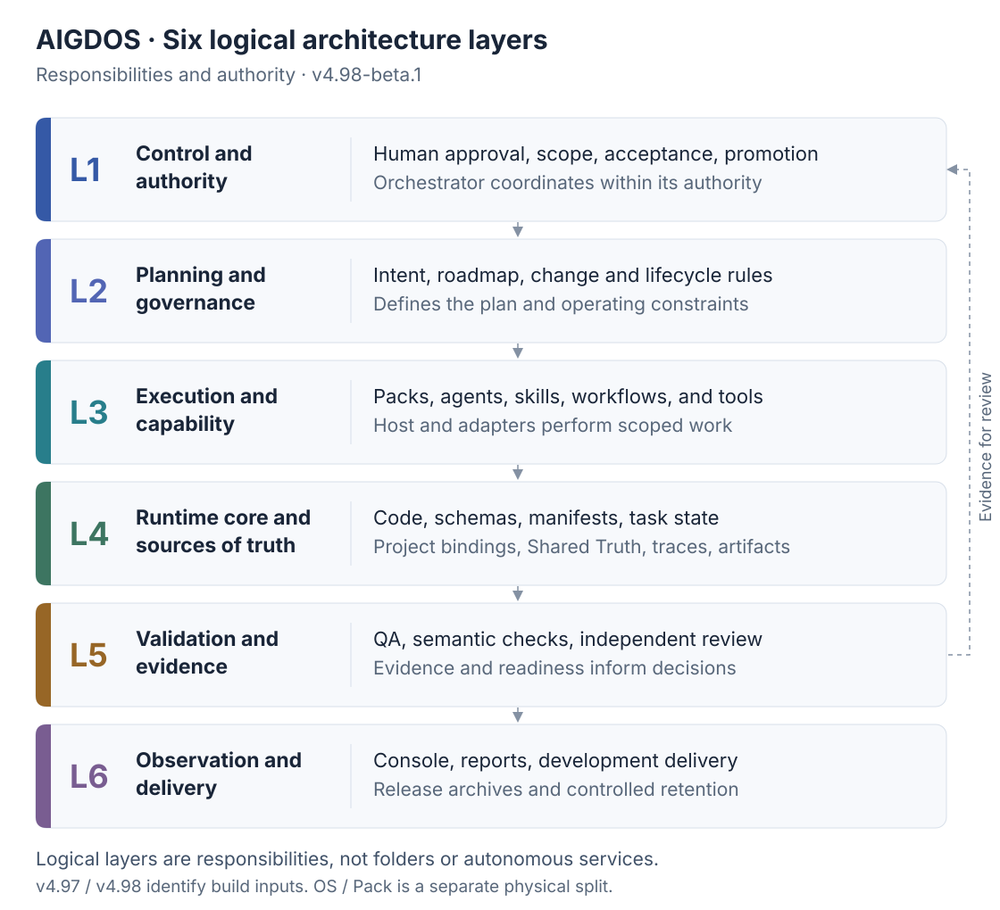
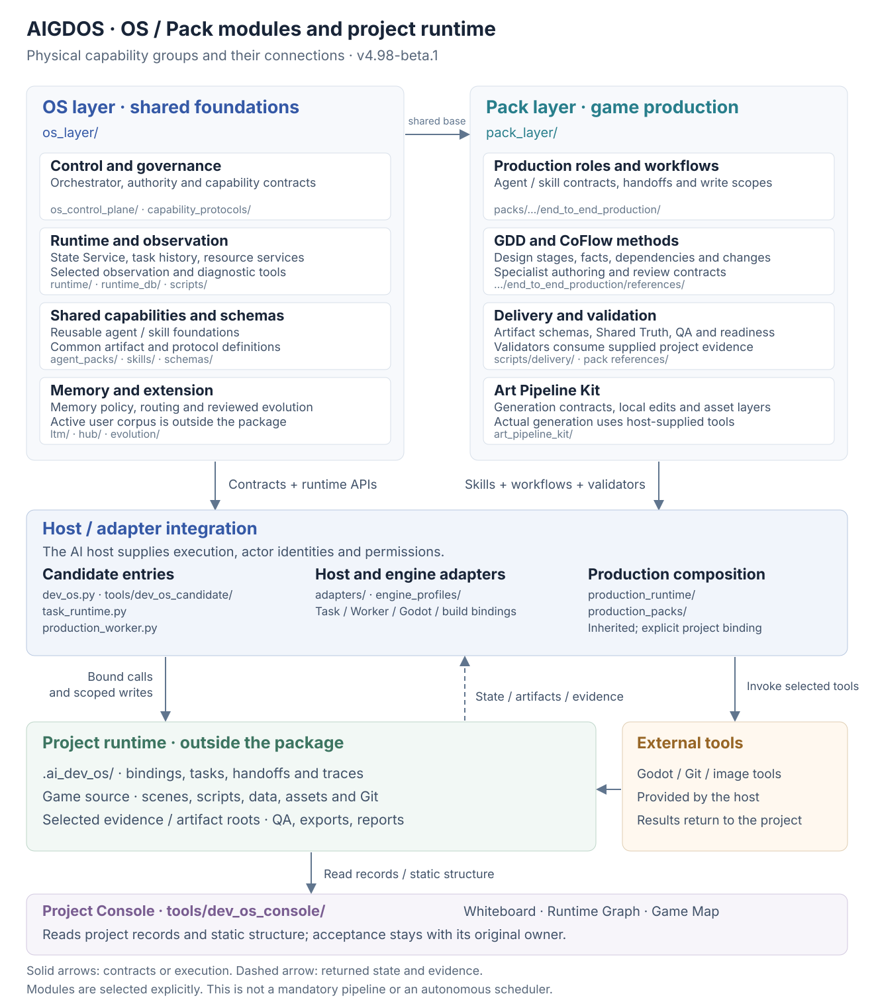

# AIGDOS Architecture: Layers, Packages, and Runtime

[中文](ARCHITECTURE.md) | **English**

[Home](README.en.md) · [Full capabilities](AIGDOS_CAPABILITIES.en.md) · [Quick start](V498_BETA1_QUICKSTART.en.md)

Jump to the [concrete run-request walkthrough](#5-concrete-walkthrough-run-request-and-the-charge-meter).

**AIGDOS has six logical responsibility layers. Its physical OS/Pack split is a different view.** The v4.97 and v4.98 directories identify versioned build inputs; they are not architectural layers. A diagram of runtime connections alone cannot explain these distinctions.

This guide applies to the published **v4.98-beta.1** package. It explains the inherited architecture and where the current Beta components fit, without changing their implementation or qualification status.

## 1. The six logical layers



[Open the full-size layer diagram](docs/diagrams/layers.en.svg)

| Layer | Responsibility | Representative components and artifacts | Authority boundary |
| --- | --- | --- | --- |
| **L1 — Control and authority** | Decide goals, authorized scope, acceptance, and lifecycle promotion | Human owner/approver, governance owners, Orchestrator control capability | The Orchestrator coordinates within its contract; human approval remains the authority for promotion |
| **L2 — Planning and governance** | Translate intent into plans and operating constraints | Intent baseline, roadmap/phase status, change control, adoption/lifecycle rules, mirror and release policy | Plans and routing recommendations do not create new permissions |
| **L3 — Execution and capability** | Perform scoped design and production work | Production packs, agent/skill contracts, workflows, delivery scripts, Worker and runtime adapters; AI host and engine/tool calls | The host executes the work; role definitions do not start autonomous processes or grant write access |
| **L4 — Runtime core and sources of truth** | Maintain the concrete state and artifacts that work and checks use | Code, schemas, manifests, State Service task state, project bindings, Shared Truth, run plans, handoffs, traces, project artifacts | Package definitions, project state, and external systems keep distinct owners; no single new registry replaces them |
| **L5 — Validation and evidence** | Check results and prepare reviewable verdicts | Schema/semantic checks, focused QA, source/commit bindings, independent review evidence, reconciliation, readiness reports | A check or readiness PASS does not automatically grant human acceptance or release promotion |
| **L6 — Observation and delivery** | Present results and deliver or retain approved outputs | Console views, rendered reports, development-build receipts, release archives, retention/compaction outputs | Views and archives are outputs, not new authorities; retention and disposal keep their original conditions |

These are **responsibility layers**, not six services, processes, or directories. A capability can span layers: a Godot feature uses L3 implementation, L4 source/state, L5 checks, and L6 delivery, under L1/L2 constraints. Evidence returns to the appropriate reviewer or human decision maker; it does not approve itself.

## 2. How logical layers map to the package

The physical split separates reusable OS foundations, game-production capability, host/engine integration, and project data. It is not a one-to-one mapping to L1–L6.

### OS / Pack modules and runtime



[Open the full-size OS / Pack diagram](docs/diagrams/os-pack-runtime.en.svg)

Read the connections as follows:

1. **OS → Pack:** shared contracts, schemas, and base capability providers support game-specific production methods. The module groups summarize responsibilities within the physical directories; each box is not a separate service.
2. **OS / Pack → adapter integration:** adapters use OS contracts and runtime APIs together with selected Pack skills, workflows, and validators. The candidate entry, host/engine adapters, and production composition are selectable integration surfaces; not every command traverses all three.
3. **Adapters → project runtime and tools:** explicit bindings direct scoped writes and tool calls. Source, task state, handoffs, traces, and evidence belong to the selected project or artifact root outside the package. Godot, Git, and image tools are provided separately.
4. **Project → checks and views:** state and evidence return through the selected integration/validation entries. Console reads records and static structure. Neither a view nor a successful check substitutes for independent review or human acceptance.

The diagram combines the fixed base and selected v4.98 additions by responsibility. In particular, the current production methods and Art Pipeline Kit are in the v4.98 Pack area; the fixed base still supplies the task runtime and inherited providers. User LTM uses an explicit external corpus. OBS65 and CAP16 remain blocked.

| Physical area | What it contains | Relationship to the logical layers |
| --- | --- | --- |
| `os_layer/` | Control-plane contracts, Orchestrator/governance foundations, runtime and database surfaces, memory policies, capability protocols, OS skills, and observation foundations | Supplies control/governance and shared runtime/evidence foundations across several layers |
| `pack_layer/` | Game-production agents, skills, GDD/CoFlow methods, workflows, artifact schemas, delivery validators, and art tools where included | Specializes execution and artifact/evidence production for game development, mainly across L3–L6 |
| Base `adapters/`, `engine_profiles/`, `production_runtime/`, `production_packs/` | Host and engine bindings, Worker/execution/build integration, production composition and its contracts | Connect capability execution to runtime state and validation; inherited development limits still apply |
| Top-level `tools/` and `dev_os.py` | Current candidate entry points, selected successor adapters, packaging checks, and project Console | Expose and connect existing capabilities; they are not a separate authority layer |
| Base `schemas/` and compatibility `packs/`, `scripts/`, `tests/` | Root contracts and compatibility mirrors of pack-layer content | Schemas participate in truth and validation; mirrored files are not additional independent capabilities |
| Project/workspace outside the package | Source, scenes, data, assets, Git commits, `.ai_dev_os` runtime state, and selected evidence/artifact roots | Holds the active project's L4 state and the inputs/outputs used by L3, L5, and L6 |
| External memory and systems | Explicit LTM corpus, Godot, Git/CI, image tools, and any explicitly connected issue/document systems | Supply execution or specialized sources of truth; these are not bundled autonomous services |

`os_layer/` does more than policy: it also contains shared runtime foundations. `pack_layer/` does more than prompts: it includes contracts, scripts, schemas, and validators. Host adapters execute against those definitions rather than redefining them.

## 3. What v4.97 and v4.98 mean here

```text
DevOS-v4.98-beta-integration/
  dev_os.py
  candidate_manifest.json
  AI_Game_Dev_OS_v4.97/       # Fixed base, original bytes
    os_layer/
    pack_layer/
    adapters/
    engine_profiles/
    production_runtime/
    production_packs/
    schemas/
  AI_Game_Dev_OS_v4.98/       # Selected additions, not a standalone runtime
    os_layer/
    pack_layer/
  tools/                    # Candidate entries, successors, Console
```

Both version directories contain OS and Pack areas. The complete Beta combines the fixed base with selected additions and tools. The v4.98 directory alone does not supply the full task runtime. Compatibility mirrors and other package files are omitted from this abbreviated tree.

Project state and user memory live outside this package. Historical `.dev_os_meta` evidence and governance materials from the development checkout are not a required bundled runtime dependency.

## 4. Execution and data flow

The following is the runtime-connection view. Read it after the layer map: boxes here are components and data locations, not L1–L6 layers.



[Open SVG](docs/diagrams/architecture.en.svg) · [Mermaid source](docs/diagrams/architecture.en.mmd)

The host reads methods and invokes selected entries and external tools. The fixed base supplies task runtime and write mechanisms; the additions supply selected production methods and tools. Console reads project records and static structure. LTM capture/query uses an explicit external corpus. These arrows do not mean every module runs automatically or that one component can take over another's authority.

The separate [delivery flow](AIGDOS_CAPABILITIES.en.md#delivery-flow) explains why `run-request` ending at `CLAIMED_DONE` still leaves independent review and human acceptance to be completed.

## 5. Concrete walkthrough: run-request and the charge meter

This walkthrough traces the **code shipped in v4.98-beta.1**. It describes the expected successful path, not a newly executed test or a new acceptance result. Use the [quick start](V498_BETA1_QUICKSTART.en.md) to download, check SHA-256, and install dependencies first.

### Start with a bounded request

From the extracted package root, inspect `tools/dev_os_candidate/examples/charge_meter.json`, then run:

```sh
python3 -B dev_os.py doctor --profile godot
python3 -B dev_os.py run-request \
  --request tools/dev_os_candidate/examples/charge_meter.json \
  --workspace "/absolute/new-game-run"
```

Replace `/absolute/new-game-run` with a new directory outside the package whose parent already exists. Proceed only after `doctor` passes. If Godot is not discoverable, pass `--godot /absolute/path/to/godot` to both commands. `run-request` also performs its own Godot preflight.

The request supplies the scaffold, source writes, test script, expected pass token, actor identity, and layout input. Its meter starts with three charges; nine assertions cover spending, refusal without unwanted mutation, reset, and consumption of the actual layout result. The layout calculation leaves **196 px** for the label: `240 - 8 - 8 - 4 - 24`. This is a headless feature example; it does not create a playable main scene. The caller/host authors and reviews the code; the command does not invoke a model to invent it.

### Follow the modules and adapters

In the table below, `BASE` means `AI_Game_Dev_OS_v4.97/`, and `PACK` means `AI_Game_Dev_OS_v4.98/pack_layer/packs/game_system_packs/end_to_end_production/`. These are path abbreviations, not shell variables.

| Step | Modules actually used | What happens and what to inspect |
| --- | --- | --- |
| 1. Enter and initialize | `dev_os.py` → `tools/dev_os_candidate/runtime.py`; candidate package verifier and `doctor` | Check the installed package and host tools, save the request, create `project/`, and write the scaffold, Console instructions in `AGENTS.md`, and package/project binding marker. Local Git is initialized in this new project. |
| 2. Consume a Pack tool | `PACK/scripts/layout_budget.py` | Execute the request's `axis_budget` calculation. Save its input, output, and tool hash in `evidence/layout-tool.json`, and its runtime-consumable output in `project/data/candidate_layout_result.json`. The scaffold and this data become the initial input commit. |
| 3. Create and resume OS task state | Successor `tools/dev_os_candidate/task_runtime.py` over `BASE/adapters/codex/development_task_adapter.py`; OS `scripts/runtime_state/task_workflow.py`, State Service, and `scripts/runtime/state_transition_engine.py` | Create and resume the same task in separate processes, reaching `IN_PROGRESS`. The fixed State Service owns the persistent state, revision checks, handoffs, and history; the successor adds execution-participant tracking and independence checks. |
| 4. Apply the bounded feature | Successor `tools/dev_os_candidate/production_worker.py` over `BASE/adapters/codex/production_worker.py`; `PACK/agents/godot_runtime_slice_engineer.json`, `PACK/skills/godot_runtime_feature_slice_skill.json`, and `BASE/adapters/codex/bindings/godot_runtime_feature_slice.binding.json` | Preflight the role, skill, and tool binding. Register the writer and apply only declared source paths under the cooperative write protocol. `writes.json` records actual file hashes; the example creates `scripts/charge_meter.gd` and `tests/check.gd`. The scaffold's `project.godot` was initialized by the entry, not edited by the feature Worker. |
| 5. Check through the engine adapter | The inherited Worker uses `BASE/adapters/codex/godot_execution_adapter.py` and the host's Godot executable | Run project import/load and `tests/check.gd`, requiring successful execution and the expected `CANDIDATE_BEHAVIOR_PASS` token. Keep the command, stdout/stderr, exit status, and diagnostic fields in `godot-load.json` and `godot-smoke.json`. |
| 6. Bind the claim and hand off | Candidate runtime plus the same task successor and OS State Service | Commit the supplied implementation and generated GDScript UID sidecars locally. Bind implementation references to that commit and output references to the two Godot reports; move to `CLAIMED_DONE`, then send a handoff to `candidate-independent-review`. Save the claim, handoff, and run result. |

This path uses the Pack's **feature contract and layout script**. It does not automatically run GDD/CoFlow orchestration, Art Pipeline Kit, the separate focused-QA skill, Production Assembly, LTM capture, or a formal export build. `doctor` checking that dependency packs/providers are present does not mean their production workflows ran. Host-supplied identities and cooperative writes also do not provide authentication or an operating-system sandbox.

### Locate state, source, and evidence

After a successful run, the relevant layout is:

```text
/absolute/new-game-run/
  request.json
  project/
    .dev_os_candidate_project
    AGENTS.md
    project.godot
    spec.json
    scripts/charge_meter.gd
    tests/check.gd
    data/candidate_layout_result.json
    .git/
    .ai_dev_os/development/runtime_state/
      runtime-state.development.sqlite3
  evidence/
    doctor.json
    layout-tool.json
    task-created.json
    task-resumed.json
    worker-preflight.json
    writes.json
    godot-load.json
    godot-smoke.json
    task-claim.json
    review-handoff.json
    result.json
```

The SQLite database is the live runtime authority for tasks, participants, handoffs, and state history. The `.dev_os_candidate_project` marker binds this project to the candidate manifest; `.git/` retains input and implementation commits. The JSON files under `evidence/` are captured outputs, not another live task registry. In this example, command traces are in the Godot reports; no separate trace directory should be inferred from the general architecture diagram.

Read `evidence/result.json` for the actual `task_id`, `implementation_commit`, `runtime_sources`, and package hash. On the successful execution path it reports `status: PASS`, `task_state: CLAIMED_DONE`, `review_status: PENDING`, `human_acceptance: false`, and `production_release_build: NOT_RUN`. **That file remains a record of the run even after a reviewer later closes the task.** Query the runtime for subsequent state. Caught execution failures preserve the workspace and write `evidence/failure.json`; early validation/preflight rejection can happen before the workspace is created.

### Complete independent review

An independent reviewer, represented by the handoff's assigned host identity, first checks the queue:

```sh
python3 -B dev_os.py review \
  --project "/absolute/new-game-run/project" \
  --actor candidate-independent-review --action queue
```

Use the returned `tasks[].object_id` and `assigned_handoffs[].object_id`; the latter is the `handoff_id` accepted by the commands. Compare them with `result.json` and `review-handoff.json`. Review the actual implementation commit, source, layout input/output, write hashes, and Godot results. Perform any additional checks needed for the stated criteria and save the real findings, for example in `/absolute/new-game-run/review/review.md`. This reviewer-created directory/file is **not** generated by `run-request`.

Each mutating review action reads JSON from stdin. For example, after preparing a real `accept-handoff.json`:

```sh
python3 -B dev_os.py review \
  --project "/absolute/new-game-run/project" \
  --actor candidate-independent-review --action accept-handoff \
  < "/absolute/new-game-run/review/accept-handoff.json"
```

Follow this sequence, replacing `--action` and the input file for each step. The angle-bracket values below are placeholders for the current run, not values to submit unchanged.

| Action | JSON input | Effect |
| --- | --- | --- |
| `accept-handoff` | `{"handoff_id":"<actual handoff ID>"}` | The assigned independent reviewer accepts the review handoff. |
| `complete-handoff` | `{"handoff_id":"<actual handoff ID>","completion_notes":"<actual review findings>","output_refs":["/absolute/new-game-run/review/review.md"]}` | Record the completed review work and a nonempty reference to real review evidence. Completing a handoff does not itself approve the task. |
| `pass` **or** `reject` | PASS: `{"task_id":"<actual task ID>","reviewed_commit":"<full implementation commit>"}`. Rejection additionally requires `"findings_summary":"<actual defects/rework required>"`. | Submit the review verdict against the claimed implementation. For PASS, supply the actual optional `p2_findings` count if nonzero; do not issue PASS with unresolved blocking findings. |

On PASS, the supported path records `CLAIMED_DONE → VERIFIED → CLOSED` only after its gates pass, including matching implementation/claimed commits and no open handoffs. Rejection returns the task to `IN_PROGRESS` for rework. Creators, execution participants, writers, progress contributors, and claimants cannot independently approve that task; changing the actor label is not a substitute for independent review. Review transitions cannot edit the work product. Retain the returned verdict/closure output as review evidence: a successfully closed task leaves the pending-review queue. None of these actions records human acceptance or release qualification.

### Record human acceptance separately

`run-request` does not create or accept a shared Whiteboard task. After independent review, the host prepares a separate task with the agreed criteria and explicit references to the runtime task, implementation commit, review verdict, and observed results. For this walkthrough, use the **game project** as the Whiteboard root:

```sh
python3 -B tools/dev_os_whiteboard/server.py \
  --root "/absolute/new-game-run/project" --port 8767
```

Open the local URL printed by the server. Its shared task records are created at `project/.dev_os_meta/project_board/tasks/<board-task-id>.json`; evidence snapshots are saved under `project/.dev_os_meta/project_board/evidence_snapshots/`. These records are distinct from the runtime database and are created only when the Whiteboard workflow is used. The command above does not start a runtime-observation bridge or automatically import the runtime task.

Whiteboard evidence references must name real files **inside its selected root**. Since the original `evidence/` is a sibling of `project/`, do not submit `../evidence/...`. Preserve the originals and prepare byte-identical copies of the selected reports and actual review/closure output under, for example, `project/docs/acceptance/charge-meter/`, retaining their commit/hash bindings. Include relevant project source files in the explicit evidence set when they are part of the criteria. This preparation is a host follow-up, not an automatic CLI output.

The host creates/starts the shared task and claims completion with those files (`planned → in_progress → claimed_done`). The human then opens **View acceptance / 查看验收**, inspects the evidence, checks every agreed criterion, and chooses **Confirm acceptance / 确认验收** or returns it for rework. The service saves the human confirmation and verifies it by readback; `accepted` is the Whiteboard state, while `CLOSED` remains the separate runtime state. Check `confirmation_current` and `workspace_matches_evidence` separately: a valid historical snapshot does not assert that subsequently changed source still matches it.

Console is useful for viewing project records and static structure; its open/refresh receipt is not acceptance. Optional formal exports, art work, memory capture, or broader game QA require their own inputs and evidence. **This example, its review, and its human acceptance do not lift OBS65/CAP16 or confer full-release qualification.**

## 6. Sources and limits

The six-layer model and OS/Pack separation are grounded in these files inside the published ZIP:

- `AI_Game_Dev_OS_v4.97/DESIGN_AND_CAPABILITY_ARCHITECTURE.md`
- `AI_Game_Dev_OS_v4.97/OS_PACK_LAYER_MAP.md`

These inherited documents retain historical status sections. For current included components and bounded implementation status, read them alongside the base `README.md` and `V497_DEVELOPMENT_STATUS.md`, the increment `AI_Game_Dev_OS_v4.98/README.md`, and `tools/dev_os_candidate/README.md`. Current public limits are summarized in the [release notes](V498_BETA1_RELEASE_NOTES.en.md).

The walkthrough follows the packaged `tools/dev_os_candidate/runtime.py`, `task_runtime.py`, `production_worker.py`, and `examples/charge_meter.json`; the base task/Godot adapters and `os_layer/scripts/runtime_state/` implementation; and `tools/dev_os_whiteboard/shared_tasks.py`, `evidence_snapshots.py`, and `README.md`. Paths describe the shipped implementation, not extra installed services.

This architecture describes responsibilities and implementation locations, not proof that every path is fully qualified. **OBS65 and CAP16 remain blocked; the Beta has not achieved full formal-release qualification.**
