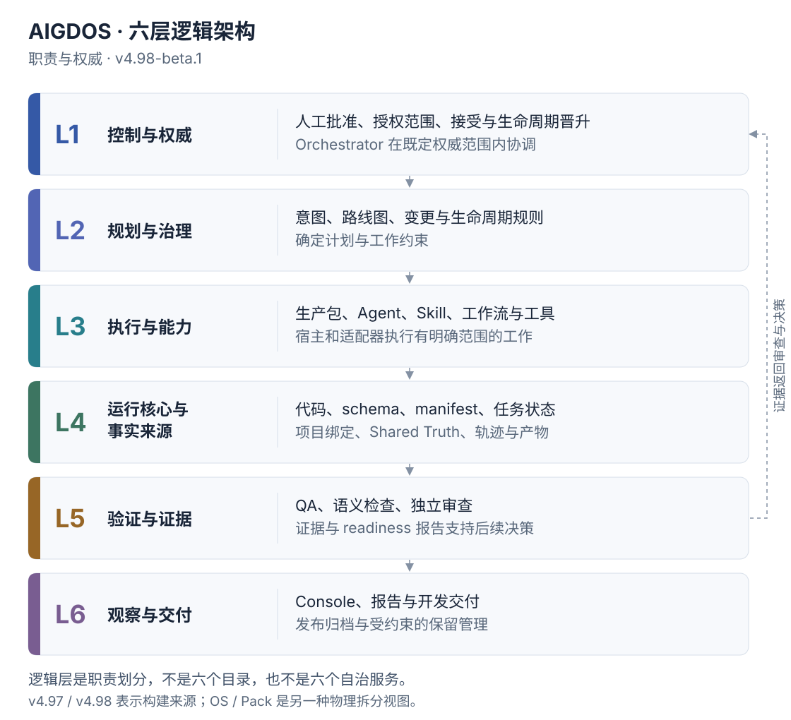
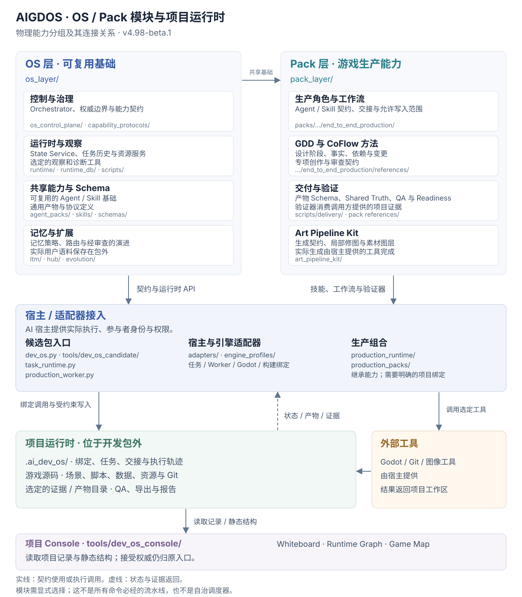

# AIGDOS 架构：逻辑层、包结构与运行关系

**中文** | [English](ARCHITECTURE.en.md)

[首页](README.md) · [完整能力说明](AIGDOS_CAPABILITIES.md) · [新用户指南](V498_BETA1_QUICKSTART.md)

**AIGDOS 有六个逻辑职责层；物理目录中的 OS / Pack 拆分是另一种视图。** v4.97 和 v4.98 目录表示构建所用的版本来源，不是架构层。只画运行时连接，无法说明这些区别。

本文适用于已发布的 **v4.98-beta.1**，说明继承的架构和当前 Beta 组件的位置，不改变实现或资格状态。

## 1. 六个逻辑层



[查看完整分层图](docs/diagrams/layers.zh.svg)

| 层 | 职责 | 代表组件与产物 | 权威边界 |
| --- | --- | --- | --- |
| **L1 — 控制与权威** | 决定目标、授权范围、接受与生命周期晋升 | 人类负责人/批准者、治理负责人、Orchestrator 控制能力 | Orchestrator 在契约内协调；晋升最终仍由人工批准 |
| **L2 — 规划与治理** | 将意图转为计划和工作约束 | 意图基线、路线图/阶段状态、变更控制、采用/生命周期规则、镜像与发布策略 | 计划与路由建议不产生新的权限 |
| **L3 — 执行与能力** | 执行有明确范围的设计和生产工作 | 生产包、Agent/Skill 契约、工作流、交付脚本、Worker 与运行适配器；AI 宿主和引擎/工具调用 | 宿主实际执行；角色定义不会自行启动进程或取得写权限 |
| **L4 — 运行核心与事实来源** | 维护执行和检查所依据的具体状态与产物 | 代码、schema、manifest、State Service 任务状态、项目绑定、Shared Truth、运行计划、交接、轨迹和项目产物 | 包定义、项目状态与外部系统各有 owner，不由一个新登记表统一取代 |
| **L5 — 验证与证据** | 检查结果，准备可复核的结论 | schema/语义检查、定向 QA、源码/提交绑定、独立审查证据、对账和 readiness 报告 | 检查或 readiness PASS 不自动授予人工接受或发布晋升 |
| **L6 — 观察与交付** | 展示结果，交付或保留经批准的输出 | Console 视图、报告、开发构建收据、发布归档、保留/压缩产物 | 视图和归档是输出，不是新的权威；保留和处置仍遵循原条件 |

它们是**职责层**，不是六个服务、进程或目录。一项能力可以跨层：Godot 功能使用 L3 实现、L4 源码/状态、L5 检查和 L6 交付，并受 L1/L2 约束。证据回到相应审查人或人工决策者，不会自行批准自己。

## 2. 逻辑层如何落到包结构

物理拆分区分可复用 OS 基础、游戏生产能力、宿主/引擎接入和项目数据，与 L1–L6 并非一一对应。

### OS / Pack 模块与运行时



[查看完整 OS / Pack 模块图](docs/diagrams/os-pack-runtime.zh.svg)

图中的连接应这样理解：

1. **OS → Pack：**共享契约、Schema 与基础能力提供方支撑游戏专属生产方法。模块分组概括物理目录内的职责，每个方框并不是独立服务。
2. **OS / Pack → 适配接入：**适配器使用 OS 契约、运行时 API，以及选定的 Pack 技能、工作流和验证器。候选包入口、宿主/引擎适配器、生产组合是可选的接入区域，并非每条命令都会经过三者。
3. **适配器 → 项目运行时与工具：**明确的绑定引导受约束写入和工具调用。源码、任务状态、交接、轨迹和证据属于包外选定项目或产物目录。Godot、Git 和图像工具另行提供。
4. **项目 → 检查与视图：**状态和证据通过选定接入/验证入口返回。Console 读取记录与静态结构；视图或检查通过都不能替代独立审查和人工接受。

本图按职责组合展示固定基座与选定 v4.98 增量。当前生产方法和 Art Pipeline Kit 位于 v4.98 的 Pack 区域，固定基座仍提供任务运行时和继承的基础能力。用户 LTM 使用明确的外部语料。OBS65、CAP16 继续阻断。

| 物理区域 | 包含什么 | 与逻辑层的关系 |
| --- | --- | --- |
| `os_layer/` | 控制面契约、Orchestrator/治理基础、运行时与数据库、记忆策略、能力协议、OS 技能与观察基础 | 跨多个逻辑层提供控制、治理及共享运行时/证据基础 |
| `pack_layer/` | 游戏生产 Agent、Skill、GDD/CoFlow 方法、工作流、产物 schema、交付验证器，以及相应美术工具 | 将执行与产物/证据生产特化到游戏开发，主要横跨 L3–L6 |
| 基座 `adapters/`、`engine_profiles/`、`production_runtime/`、`production_packs/` | 宿主和引擎绑定、Worker/执行/构建接入、生产组合与对应契约 | 将能力执行连接到运行状态和验证；仍保留继承的研发边界 |
| 顶层 `tools/` 与 `dev_os.py` | 当前候选包入口、选定的后继适配器、打包检查与项目 Console | 提供入口并连接已有能力，不构成独立权威层 |
| 基座 `schemas/` 与兼容 `packs/`、`scripts/`、`tests/` | 根契约与 pack-layer 内容的兼容镜像 | schema 参与事实与验证；镜像不是额外的独立能力 |
| 包外项目/工作区 | 源码、场景、数据、资源、Git 提交、`.ai_dev_os` 运行状态与明确选择的证据/产物目录 | 保存当前项目 L4 状态，以及 L3、L5、L6 使用的输入和输出 |
| 外部记忆与系统 | 显式 LTM 语料、Godot、Git/CI、图像工具，以及明确接入的问题/文档系统 | 提供执行能力或特定事实来源；不是包内自带的自治服务 |

`os_layer/` 不只包含策略，还包含共享运行基础；`pack_layer/` 不只包含提示词，还包含契约、脚本、schema 和验证器。宿主适配器消费这些定义，而不是重新定义它们。

## 3. 这里的 v4.97 与 v4.98 表示什么

```text
DevOS-v4.98-beta-integration/
  dev_os.py
  candidate_manifest.json
  AI_Game_Dev_OS_v4.97/       # 固定基座，保持原字节
    os_layer/
    pack_layer/
    adapters/
    engine_profiles/
    production_runtime/
    production_packs/
    schemas/
  AI_Game_Dev_OS_v4.98/       # 选定增量，不是独立运行时
    os_layer/
    pack_layer/
  tools/                    # 候选包入口、后继工具、Console
```

两个版本目录都包含 OS 和 Pack 区域。完整 Beta 将固定基座、选定增量和工具组合交付；单独的 v4.98 目录不提供完整任务运行时。上面的简化树省略了兼容镜像和其他包文件。

项目状态与用户记忆保存在包外。原开发工作区的历史 `.dev_os_meta` 证据和治理材料，不是必须随包提供的运行依赖。

## 4. 执行与数据流

下面是运行连接视图，应该结合分层图阅读：这里的方框表示组件和数据位置，不是 L1–L6 逻辑层。



[查看 SVG 原图](docs/diagrams/architecture.zh.svg) · [Mermaid 源文件](docs/diagrams/architecture.zh.mmd)

宿主读取方法，调用选定入口与外部工具。固定基座提供任务运行时和写入机制，增量提供选定生产方法与工具。Console 读取项目记录与静态结构；LTM 捕获/查询使用明确的外部语料。这些箭头不表示全部模块自动执行，也不意味着某个组件能够接管其他组件的权威。

另见[交付流程](AIGDOS_CAPABILITIES.md#交付流程)：`run-request` 到达 `CLAIMED_DONE` 后，独立审查和人工接受仍需分别完成。

## 5. 来源与边界

六层模型与 OS / Pack 分离依据已发布 ZIP 中的：

- `AI_Game_Dev_OS_v4.97/DESIGN_AND_CAPABILITY_ARCHITECTURE.md`
- `AI_Game_Dev_OS_v4.97/OS_PACK_LAYER_MAP.md`

这些继承文档保留了历史状态段落。当前随包组件和有界实现状态，应结合基座 `README.md`、`V497_DEVELOPMENT_STATUS.md`、增量 `AI_Game_Dev_OS_v4.98/README.md` 和 `tools/dev_os_candidate/README.md` 阅读。当前公众分发边界见[版本说明](V498_BETA1_RELEASE_NOTES.md)。

本架构说明职责与实现位置，不代表每条路径均已取得完整资格。**OBS65、CAP16 继续阻断；本 Beta 尚未取得完整正式版本资格。**
