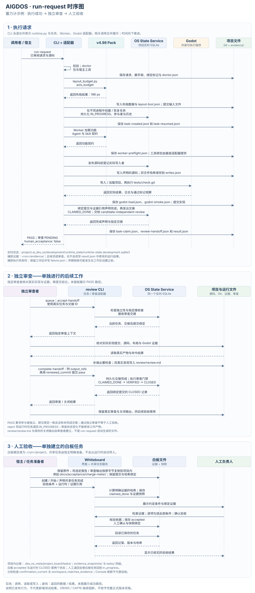

# AIGDOS 架构：逻辑层、包结构与运行关系

**中文** | [English](ARCHITECTURE.en.md)

[首页](README.md) · [完整能力说明](AIGDOS_CAPABILITIES.md) · [新用户指南](V498_BETA1_QUICKSTART.md)

直接查看 [run-request 具体走读](#5-具体走读run-request-与蓄力计示例)。

**AIGDOS 有六个逻辑职责层；物理目录中的 OS / Pack 拆分是另一种视图。** v4.97 和 v4.98 目录表示构建所用的版本来源，不是架构层。只画运行时连接，无法说明这些区别。

本文适用于已发布的 **v4.98-beta.1**，说明继承的架构和当前 Beta 组件的位置，不改变实现或资格状态。

## 1. 六个逻辑层


[查看完整分层图](docs/diagrams/layers.zh.svg)

| 层 | 职责 | 代表组件与产物 | 权威边界 |
| --- | --- | --- | --- |
| **L1 — 控制与权威** | 决定目标、授权范围、接受与生命周期晋升 | 人类负责人/批准者、治理负责人、Orchestrator 控制能力 | Orchestrator 在契约内协调；晋升最终仍由人工批准 |
| **L2 — 规划与治理** | 将意图转为计划和工作约束 | 意图基线、路线图/阶段状态、变更控制、采用/生命周期规则、镜像与发布策略 | 计划与路由建议不产生新的权限 |
| **L3 — 执行与能力** | 执行有明确范围的设计和生产工作 | 生产包、Agent/Skill 契约、工作流、交付脚本、Worker 与运行适配器；AI 宿主和引擎/工具调用 | 宿主实际执行；角色定义不会自行启动进程或取得写权限 |
| **L4 — 运行核心与事实来源** | 维护执行和检查所依据的具体状态与产物 | 代码、schema、manifest、State Service 任务状态、项目绑定、Shared Truth、运行计划、交接、轨迹和项目产物 | 包定义、项目状态与外部系统各有 owner，不由一个新登记表统一取代 |
| **L5 — 验证与证据** | 检查结果，准备可复核的结论 | schema/语义检查、定向 QA、源码/提交绑定、独立审查证据、对账和 readiness 报告 | 检查或 readiness PASS 不自动授予人工接受或发布晋升 |
| **L6 — 观察与交付** | 展示结果，交付或保留经批准的输出 | Console 视图、报告、开发构建收据、发布归档、保留/压缩产物 | 视图和归档是输出，不是新的权威；保留和处置仍遵循原条件 |

它们是**职责层**，不是六个服务、进程或目录。一项能力可以跨层：Godot 功能使用 L3 实现、L4 源码/状态、L5 检查和 L6 交付，并受 L1/L2 约束。证据回到相应审查人或人工决策者，不会自行批准自己。

## 2. 逻辑层如何落到包结构

物理拆分区分可复用 OS 基础、游戏生产能力、宿主/引擎接入和项目数据，与 L1–L6 并非一一对应。

### OS / Pack 模块与运行时


[查看完整 OS / Pack 模块图](docs/diagrams/os-pack-runtime.zh.svg)

图中的连接应这样理解：

1. **OS → Pack：** 共享契约、Schema 与基础能力提供方支撑游戏专属生产方法。模块分组概括物理目录内的职责，每个方框并不是独立服务。
2. **OS / Pack → 适配接入：** 适配器使用 OS 契约、运行时 API，以及选定的 Pack 技能、工作流和验证器。候选包入口、宿主/引擎适配器、生产组合是可选的接入区域，并非每条命令都会经过三者。
3. **适配器 → 项目运行时与工具：** 明确的绑定引导受约束写入和工具调用。源码、任务状态、交接、轨迹和证据属于包外选定项目或产物目录。Godot、Git 和图像工具另行提供。
4. **项目 → 检查与视图：** 状态和证据通过选定接入/验证入口返回。Console 读取记录与静态结构；视图或检查通过都不能替代独立审查和人工接受。

本图按职责组合展示固定基座与选定 v4.98 增量。当前生产方法和 Art Pipeline Kit 位于 v4.98 的 Pack 区域，固定基座仍提供任务运行时和继承的基础能力。用户 LTM 使用明确的外部语料。OBS65、CAP16 继续阻断。

| 物理区域 | 包含什么 | 与逻辑层的关系 |
| --- | --- | --- |
| `os_layer/` | 控制面契约、Orchestrator/治理基础、运行时与数据库、记忆策略、能力协议、OS 技能与观察基础 | 跨多个逻辑层提供控制、治理及共享运行时/证据基础 |
| `pack_layer/` | 游戏生产 Agent、Skill、GDD/CoFlow 方法、工作流、产物 schema、交付验证器，以及相应美术工具 | 将执行与产物/证据生产特化到游戏开发，主要横跨 L3–L6 |
| 基座 `adapters/`、`engine_profiles/`、`production_runtime/`、`production_packs/` | 宿主和引擎绑定、Worker/执行/构建接入、生产组合与对应契约 | 将能力执行连接到运行状态和验证；仍保留继承的研发边界 |
| 顶层 `tools/` 与 `dev_os.py` | 当前候选包入口、选定的后继适配器、打包检查与项目 Console | 提供入口并连接已有能力，不构成独立权威层 |
| 基座 `schemas/` 与兼容 `packs/`、`scripts/`、`tests/` | 根契约与 pack-layer 内容的兼容镜像 | schema 参与事实与验证；镜像不是额外的独立能力 |
| 包外项目/工作区 | 源码、场景、数据、资源、Git 提交、`.ai_dev_os` 运行状态与明确选择的证据/产物目录 | 保存当前项目 L4 状态，以及 L3、L5、L6 使用的输入和输出 |
| 外部记忆与系统 | 显式 LTM 语料、Godot、Git/CI、图像工具，以及明确接入的问题/文档系统 | 提供执行能力或特定事实来源；不是包内自带的自治服务 |

`os_layer/` 不只包含策略，还包含共享运行基础；`pack_layer/` 不只包含提示词，还包含契约、脚本、schema 和验证器。宿主适配器消费这些定义，而不是重新定义它们。

## 3. 这里的 v4.97 与 v4.98 表示什么

```text
DevOS-v4.98-beta-integration/
  dev_os.py
  candidate_manifest.json
  AI_Game_Dev_OS_v4.97/       # 固定基座，保持原字节
    os_layer/
    pack_layer/
    adapters/
    engine_profiles/
    production_runtime/
    production_packs/
    schemas/
  AI_Game_Dev_OS_v4.98/       # 选定增量，不是独立运行时
    os_layer/
    pack_layer/
  tools/                    # 候选包入口、后继工具、Console
```

两个版本目录都包含 OS 和 Pack 区域。完整 Beta 将固定基座、选定增量和工具组合交付；单独的 v4.98 目录不提供完整任务运行时。上面的简化树省略了兼容镜像和其他包文件。

项目状态与用户记忆保存在包外。原开发工作区的历史 `.dev_os_meta` 证据和治理材料，不是必须随包提供的运行依赖。

## 4. 执行与数据流

下面是运行连接视图，应该结合分层图阅读：这里的方框表示组件和数据位置，不是 L1–L6 逻辑层。


[查看 SVG 原图](docs/diagrams/architecture.zh.svg) · [Mermaid 源文件](docs/diagrams/architecture.zh.mmd)

宿主读取方法，调用选定入口与外部工具。固定基座提供任务运行时和写入机制，增量提供选定生产方法与工具。Console 读取项目记录与静态结构；LTM 捕获/查询使用明确的外部语料。这些箭头不表示全部模块自动执行，也不意味着某个组件能够接管其他组件的权威。

另见[交付流程](AIGDOS_CAPABILITIES.md#交付流程)：`run-request` 到达 `CLAIMED_DONE` 后，独立审查和人工接受仍需分别完成。

## 5. 具体走读：run-request 与蓄力计示例

本节沿着 **v4.98-beta.1 已发布代码**说明预期成功路径，不代表新执行了一轮测试或新增验收结果。请先按[快速上手](V498_BETA1_QUICKSTART.md)下载、核对 SHA-256 并安装依赖。

### 时序：执行、审查与验收



[查看完整时序图（可编辑 SVG）](docs/diagrams/run-request-sequence.zh.svg)

每个编号面板从上向下阅读。执行泳道合并表示候选入口及任务/Worker/Godot 适配器，下方模块表给出其准确文件。实线表示调用、读取或写入，虚线表示返回数据或结果；相关调用合并展示以便阅读。本图沿成功路径展开，并注明失败/返工结果。**独立审查和白板验收是明确进行的后续工作，不是 `run-request` 自动执行的下一步。** 实时运行状态、捕获的运行证据、白板记录与快照分别保存在各自位置，保留各自权威。

### 从有明确边界的请求开始

在解包根目录检查 `tools/dev_os_candidate/examples/charge_meter.json`，再运行：

```sh
python3 -B dev_os.py doctor --profile godot
python3 -B dev_os.py run-request \
  --request tools/dev_os_candidate/examples/charge_meter.json \
  --workspace "/absolute/new-game-run"
```

将 `/absolute/new-game-run` 替换为包外全新目录，父目录必须已存在。只有 `doctor` 通过后才继续；如不能自动找到 Godot，为两条命令都添加 `--godot /absolute/path/to/godot`。`run-request` 自身也会执行 Godot 预检。

请求提供脚手架、源码写入、测试脚本、预期通过标记、执行者身份与布局输入。示例初始有三格能量，九项断言检查消耗、拒绝且不产生意外状态变化、重置，以及读取真实布局结果。布局计算为标签留下 **196 px**：`240 - 8 - 8 - 4 - 24`。这是无窗口的功能示例，不会创建可游玩的主场景。源码由调用者/宿主编写并审阅，命令不会调用模型替它生成。

### 沿模块与适配器追踪

下表用 `BASE` 表示 `AI_Game_Dev_OS_v4.97/`，用 `PACK` 表示 `AI_Game_Dev_OS_v4.98/pack_layer/packs/game_system_packs/end_to_end_production/`。它们是路径缩写，不是 shell 变量。

| 步骤 | 实际使用的模块 | 发生什么、检查什么 |
| --- | --- | --- |
| 1. 进入并初始化 | `dev_os.py` → `tools/dev_os_candidate/runtime.py`；候选包校验器与 `doctor` | 核对已安装包和宿主工具，保存请求，创建 `project/`，写入脚手架、`AGENTS.md` 中的 Console 指令，以及包/项目绑定标记。在这个新项目中初始化本地 Git。 |
| 2. 消费 Pack 工具 | `PACK/scripts/layout_budget.py` | 执行请求中的 `axis_budget` 计算。输入、输出与工具哈希写入 `evidence/layout-tool.json`；供项目读取的结果写入 `project/data/candidate_layout_result.json`。脚手架与该数据形成初始输入提交。 |
| 3. 建立并恢复 OS 任务状态 | `tools/dev_os_candidate/task_runtime.py` 后继入口复用 `BASE/adapters/codex/development_task_adapter.py`；OS 的 `scripts/runtime_state/task_workflow.py`、State Service 与 `scripts/runtime/state_transition_engine.py` | 在不同进程中创建并恢复同一任务，进入 `IN_PROGRESS`。固定 State Service 持有持久状态、版本检查、交接与历史；后继入口增加执行参与者记录和独立性检查。 |
| 4. 写入限定功能 | `tools/dev_os_candidate/production_worker.py` 后继入口复用 `BASE/adapters/codex/production_worker.py`；`PACK/agents/godot_runtime_slice_engineer.json`、`PACK/skills/godot_runtime_feature_slice_skill.json` 与 `BASE/adapters/codex/bindings/godot_runtime_feature_slice.binding.json` | 预检角色、技能和工具绑定；登记写入者，按协作写入协议只写声明的源码路径。`writes.json` 保存实际文件哈希；示例创建 `scripts/charge_meter.gd` 和 `tests/check.gd`。脚手架中的 `project.godot` 由入口初始化，不是功能 Worker 修改的。 |
| 5. 经引擎适配器检查 | 继承的 Worker 使用 `BASE/adapters/codex/godot_execution_adapter.py` 与宿主提供的 Godot 可执行文件 | 执行项目导入/加载和 `tests/check.gd`，要求执行成功并出现预期 `CANDIDATE_BEHAVIOR_PASS` 标记。命令、stdout/stderr、退出状态及诊断字段保存在 `godot-load.json` 与 `godot-smoke.json`。 |
| 6. 绑定完成声明并交接 | 候选入口、同一任务后继适配器与 OS State Service | 本地提交调用者提供的实现与生成的 GDScript UID 文件。实现引用绑定该提交，产物引用绑定两份 Godot 报告；进入 `CLAIMED_DONE`，再向 `candidate-independent-review` 发出交接。保存声明、交接和运行结果。 |

本路径使用 Pack 的**功能契约和布局脚本**，不会自动运行 GDD/CoFlow 编排、Art Pipeline Kit、单独的 focused-QA 技能、Production Assembly、LTM 捕获或正式导出构建。`doctor` 检查依赖包/提供方存在，不代表其生产工作流已经执行。宿主提供的身份与协作写入协议也不等于身份认证或操作系统沙箱。

### 找到状态、源码与证据

成功运行后的相关目录如下：

```text
/absolute/new-game-run/
  request.json
  project/
    .dev_os_candidate_project
    AGENTS.md
    project.godot
    spec.json
    scripts/charge_meter.gd
    tests/check.gd
    data/candidate_layout_result.json
    .git/
    .ai_dev_os/development/runtime_state/
      runtime-state.development.sqlite3
  evidence/
    doctor.json
    layout-tool.json
    task-created.json
    task-resumed.json
    worker-preflight.json
    writes.json
    godot-load.json
    godot-smoke.json
    task-claim.json
    review-handoff.json
    result.json
```

SQLite 库是任务、参与者、交接与状态历史的当前运行时权威来源。`.dev_os_candidate_project` 将本项目绑定到候选包清单；`.git/` 保留输入提交和实现提交。`evidence/` 中的 JSON 是当时捕获的输出，不是另一个实时任务登记表。本例的命令执行轨迹保存在 Godot 报告中，不能从总架构图推断还生成了单独的轨迹目录。

从 `evidence/result.json` 读取真实的 `task_id`、`implementation_commit`、`runtime_sources` 与包哈希。成功执行路径报告 `status: PASS`、`task_state: CLAIMED_DONE`、`review_status: PENDING`、`human_acceptance: false` 和 `production_release_build: NOT_RUN`。**审查者后来关闭任务，也不会把该文件改成新的运行结果。** 后续状态应查询运行时。被执行入口捕获的失败会保留工作区并写入 `evidence/failure.json`；早期输入校验或预检拒绝可能发生在创建工作区之前。

### 完成独立审查

由真正独立的审查者使用交接指定的宿主身份，先查看队列：

```sh
python3 -B dev_os.py review \
  --project "/absolute/new-game-run/project" \
  --actor candidate-independent-review --action queue
```

使用返回的 `tasks[].object_id` 与 `assigned_handoffs[].object_id`；后者就是命令接收的 `handoff_id`。将它们与 `result.json`、`review-handoff.json` 对照。审阅实际实现提交、源码、布局输入/输出、写入哈希和 Godot 结果；按约定条件补做必要检查，将真实发现保存到例如 `/absolute/new-game-run/review/review.md`。这个目录/文件由审查者另行建立，**不是** `run-request` 自动生成的。

各项审查写操作通过 stdin 读取 JSON。例如，准备真实的 `accept-handoff.json` 后：

```sh
python3 -B dev_os.py review \
  --project "/absolute/new-game-run/project" \
  --actor candidate-independent-review --action accept-handoff \
  < "/absolute/new-game-run/review/accept-handoff.json"
```

按下表顺序替换 `--action` 和输入文件。尖括号中的内容是本次运行的占位说明，不能原样提交。

| 操作 | JSON 输入 | 效果 |
| --- | --- | --- |
| `accept-handoff` | `{"handoff_id":"<实际交接 ID>"}` | 指定的独立审查者接收审查交接。 |
| `complete-handoff` | `{"handoff_id":"<实际交接 ID>","completion_notes":"<真实审查发现>","output_refs":["/absolute/new-game-run/review/review.md"]}` | 记录审查工作完成，并引用真实、非空的审查证据。完成交接本身不代表任务通过。 |
| `pass` **或** `reject` | PASS：`{"task_id":"<实际任务 ID>","reviewed_commit":"<完整实现提交>"}`。拒绝还需提供 `"findings_summary":"<实际缺陷或返工要求>"`。 | 对已声明的实现提交给出审查结论。PASS 的可选 `p2_findings` 如非零，应填写真实数量；有未解决的阻断问题时不能提交 PASS。 |

PASS 路径只有在门禁通过后才记录 `CLAIMED_DONE → VERIFIED → CLOSED`，包括实现提交与声明提交一致、没有未完成交接等条件。拒绝会将任务退回 `IN_PROGRESS` 返工。任务创建者、执行参与者、写入者、进展贡献者和完成声明者都不能独立批准该任务；换一个 actor 名称不能代替独立审查。审查状态变化不能修改工作产物。应将返回的结论/关闭结果保留为审查证据：成功关闭的任务会离开待审队列。这些操作均不记录人工接受或正式版本资格。

### 单独记录人工验收

`run-request` 不会创建或接受共享白板任务。独立审查后，宿主另行准备任务，写明约定条件，并明确引用运行时任务、实现提交、审查结论与实际观察结果。本走读以**游戏项目**作为白板根目录：

```sh
python3 -B tools/dev_os_whiteboard/server.py \
  --root "/absolute/new-game-run/project" --port 8767
```

打开服务输出的本机 URL。共享任务记录位于 `project/.dev_os_meta/project_board/tasks/<白板任务ID>.json`，证据快照位于 `project/.dev_os_meta/project_board/evidence_snapshots/`。它们与运行时数据库分开，仅在使用白板工作流时创建。上述命令不会启动运行时观察桥接，也不会自动导入运行时任务。

白板证据引用必须指向**所选根目录内部**的真实文件。原始 `evidence/` 与 `project/` 同级，因此不能提交 `../evidence/...`。保留原件，将选定报告和真实审查/关闭输出按原字节复制到例如 `project/docs/acceptance/charge-meter/`，保留其提交与哈希绑定；相关项目源码若属于验收依据，也应明确列入证据集合。这是宿主后续准备工作，不是 CLI 自动输出。

宿主创建/开始共享任务，并用这些文件声明完成（`planned → in_progress → claimed_done`）。用户打开**查看验收**，检查证据，逐项勾选全部约定条件，再选择**确认验收**或退回修改。服务保存人工确认并回读核验；白板状态为 `accepted`，运行时的 `CLOSED` 仍是另一个状态。分别检查 `confirmation_current` 和 `workspace_matches_evidence`：历史快照有效，不代表后来修改的源码仍与其一致。

Console 可用于查看项目记录与静态结构，打开/刷新回执不是验收。可选的正式导出、美术工作、记忆捕获或更广泛游戏 QA 都需要各自输入和证据。**本示例及其独立审查、人工验收不会解除 OBS65/CAP16，也不授予完整正式版本资格。**

## 6. 来源与边界

六层模型与 OS / Pack 分离依据已发布 ZIP 中的：

- `AI_Game_Dev_OS_v4.97/DESIGN_AND_CAPABILITY_ARCHITECTURE.md`
- `AI_Game_Dev_OS_v4.97/OS_PACK_LAYER_MAP.md`

这些继承文档保留了历史状态段落。当前随包组件和有界实现状态，应结合基座 `README.md`、`V497_DEVELOPMENT_STATUS.md`、增量 `AI_Game_Dev_OS_v4.98/README.md` 和 `tools/dev_os_candidate/README.md` 阅读。当前公众分发边界见[版本说明](V498_BETA1_RELEASE_NOTES.md)。

走读依据包内的 `tools/dev_os_candidate/runtime.py`、`task_runtime.py`、`production_worker.py`、`examples/charge_meter.json`，基座的任务/Godot 适配器与 `os_layer/scripts/runtime_state/` 实现，以及 `tools/dev_os_whiteboard/shared_tasks.py`、`evidence_snapshots.py` 和 `README.md`。这些路径描述已发布实现，不代表额外安装的服务。

本架构说明职责与实现位置，不代表每条路径均已取得完整资格。**OBS65、CAP16 继续阻断；本 Beta 尚未取得完整正式版本资格。**
