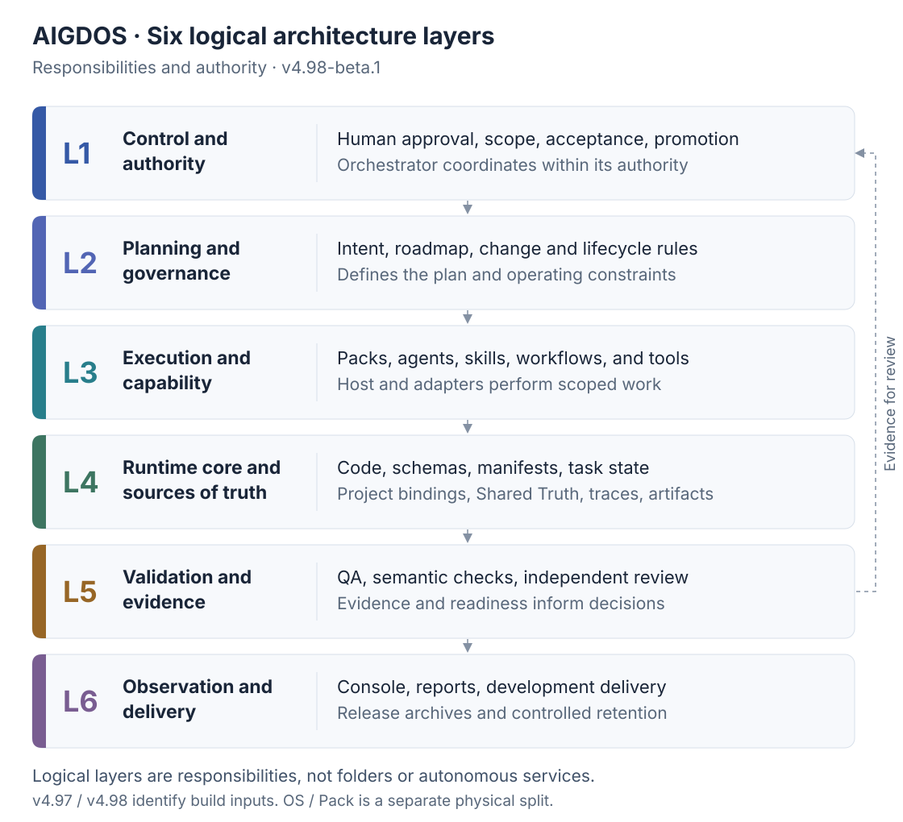

# AIGDOS — AI Game Dev OS

[中文](README.md) | **English**

**AIGDOS is a game development framework for working with AI coding assistants.** It connects game ideas, design documents, tasks, code and assets, test evidence, independent review, and human acceptance so that development can be continued, traced, and checked.

This is the public distribution repository. The current public development package is **v4.98-beta.1**, released on **November 18, 2026**, for **new Godot projects on macOS**.

[Download the complete Beta package](https://raw.githubusercontent.com/markjsun1en-sketch/AIGDOS-Releases/main/DevOS-v4.98-beta.1-candidate.zip) · [Quick start](V498_BETA1_QUICKSTART.en.md) · [Full capability guide](AIGDOS_CAPABILITIES.en.md) · [Release notes](V498_BETA1_RELEASE_NOTES.en.md) · [Build receipt](V498_BETA1_BUILD_RECEIPT.json)

## What AIGDOS is for

When developing a game, an AI assistant needs to know what to work on, which design to follow, which files it may change, and how to demonstrate completion. AIGDOS provides project instructions, specialist working methods, structured deliverable formats, command-line tools, and a local Console for these questions.

For example, when adding a charge meter to a Godot game, you can use it to organize requirements and acceptance criteria, bound the code changes, run import and behavior checks, retain the actual source commit and evidence, and hand the result to an independent reviewer and to you for acceptance. The included `charge_meter.json` demonstrates this execution chain. Larger games still require people and the AI host to break down, implement, and verify the work.

It is intended for independent developers, small teams, game designers, and technical leads who want to work with AI over time, as well as project owners who need to inspect progress and the evidence behind a delivery.

**OS** in the name refers to the development working system. AIGDOS runs on top of your operating system and AI host: Godot runs the game, the AI host handles reasoning, creation, coding, and tool calls, and AIGDOS supplies working constraints, state, and verification entry points. Models, engines, and image generation services must be provided separately.

## Dev OS architecture

Read the architecture in separate views: **L1–L6 are logical responsibility layers, OS / Pack is the physical split, and v4.97 / v4.98 identify versioned build inputs.** They are not the same hierarchy.



[Layer responsibilities, OS / Pack mapping, and package layout](ARCHITECTURE.en.md) · [Open the full-size layer diagram](docs/diagrams/layers.en.svg)

<details>
<summary>Expand execution and data flow (component relationships, not logical layers)</summary>



[Open SVG](docs/diagrams/architecture.en.svg) · [Mermaid source](docs/diagrams/architecture.en.mmd)

Arrows show calls or data relationships. They grant no permissions and do not mean every module runs automatically. The fixed base supplies the task runtime; the v4.98 additions supply methods and tools. Project state and user memory remain outside the package. Console displays records; task closure and human acceptance are still handled separately through their original entries. See the [delivery flow in the capability guide](AIGDOS_CAPABILITIES.en.md#delivery-flow) for the relationship between checks, independent review, and acceptance.

</details>

## Capability overview

| Development area | What you can use it for | Conditions and limits |
| --- | --- | --- |
| Game ideas and GDDs | Organize concept, world, mechanics, modes, balance, UI, resources, and review in stages; maintain modules, design facts, dependencies, and changes | Methods, contracts, and validators are provided; the host and people create the content |
| Tasks and collaboration | Record tasks, progress, handoffs, implementation commits, and independent reviews; distinguish claimed completion from acceptance | The runtime manages state; the host supplies actor identities and execution |
| Godot development | Organize scripts, scenes, resources, and behavior checks for a bounded feature slice; execute the example in a new directory | This Beta has tested a bounded new-project workflow on macOS / Godot 4.4 |
| Balance and data | Organize numeric models, the RawData-to-runtime chain, the formal text pipeline, and associated checks | Requires the project's actual data formats, tool bindings, and acceptance criteria |
| Art and UI | Scene, atmosphere, and concept workflows; local edits; extraction and composite previews of existing asset layers; asset acceptance and runtime binding | External tools generate images; visual quality and runtime results require separate acceptance |
| QA and development delivery | Retain focused test evidence, prepare macOS exports, verify raw bytes in PCK files, and follow the formal development build and review process | A PCK check does not establish that gameplay, signatures, and window interaction all passed |
| Local project Console | View tasks in Whiteboard, relationships in Runtime Graph, and Godot scene/script structure in Game Map | Game Map reads static declarations; page state does not replace acceptance |
| Memory and reuse | Store evidence-linked revisions of experience outside the package, consult memory, and inspect or query candidate indexes | Records lacking evidence or approval are quarantined; they do not automatically become accepted knowledge |
| Traceability and diagnostics | Check artifacts, sources, context references, task timing, explicitly supplied usage records, and bounded recovery materials | Missing observations remain unknown; diagnostics do not automatically grant completion or release qualification |

The current production pack lists **53 public skills**. See the [capability guide](AIGDOS_CAPABILITIES.en.md) for the complete list, purposes, owners, and advanced modules. These are definitions for a host to execute: the count is neither a count of autonomous agent processes nor a count of skills individually accepted in real production.

## Download and verify

New users need only the single Dev OS ZIP below. It contains the fixed v4.97 base, v4.98 additions, and supporting tools. No separate installation of an older Dev OS version is needed.

- [DevOS-v4.98-beta.1-candidate.zip](https://raw.githubusercontent.com/markjsun1en-sketch/AIGDOS-Releases/main/DevOS-v4.98-beta.1-candidate.zip) — 9,880,303 bytes, approximately 9.42 MiB.
- [SHA-256 checksum file](https://raw.githubusercontent.com/markjsun1en-sketch/AIGDOS-Releases/main/DevOS-v4.98-beta.1-candidate.zip.sha256).

```text
491387e002ab37f2db1533e6dc3b38b5854933ddb1833f97ba89f2d57f76fc7d
```

Build source commit: `e6d09e203980f5f2df0183b794248ca3b261496e`. The top-level directory in the ZIP is `DevOS-v4.98-beta-integration/`. This is the original published archive; documentation updates do not change its contents. SHA-256 verifies byte identity. See the [build receipt](V498_BETA1_BUILD_RECEIPT.json) for the publication and build identity.

## First use

You can share the [new-user introduction and quick start](V498_BETA1_QUICKSTART.en.md) directly. It includes the purpose, download links, checksum, execution steps, and Beta limits.

Required environment: macOS, Python 3.10+, Git, and Godot 4.4. Validation used Python 3.13.2; other Python versions have not been checked individually. Put the ZIP and checksum file in the same directory, and make sure the extraction, virtual environment, and project directories below do not already exist.

```sh
# The checksum must report OK. Stop and check the download if it fails.
shasum -a 256 -c DevOS-v4.98-beta.1-candidate.zip.sha256
unzip DevOS-v4.98-beta.1-candidate.zip
cd DevOS-v4.98-beta-integration

python3 -m venv ../devos-beta-venv
. ../devos-beta-venv/bin/activate
python3 -m pip install -r tools/dev_os_candidate/requirements.txt

# Check the package and Godot development dependencies.
python3 -B dev_os.py doctor --profile godot

# After doctor succeeds, run the charge-meter example outside the package.
python3 -B dev_os.py run-request \
  --request tools/dev_os_candidate/examples/charge_meter.json \
  --workspace "$PWD/../new-game-run"
```

If Godot is not detected, add `--godot /path/to/Godot/executable` to both `doctor` and `run-request`. A common macOS path is `/Applications/Godot.app/Contents/MacOS/Godot`.

On success, `new-game-run/project/` contains the project and its instructions, while `new-game-run/evidence/` contains execution evidence and the review handoff. The command creates local Git commits in the new project and finishes at **`CLAIMED_DONE` — completion claimed, independent review pending**. Independent review and human acceptance in Whiteboard are still separate steps.

`run-request` executes source code supplied by the caller in the request JSON. For your own game, first work with the AI host to define requirements, write the request and source, and review them before execution. The command has no embedded model, and the execution directory is not an operating-system sandbox.

Full instructions are in `tools/dev_os_candidate/README.md` inside the archive and in the [release notes](V498_BETA1_RELEASE_NOTES.en.md). To inspect skills and responsibilities, run:

```sh
python3 -B dev_os.py capabilities
python3 -B dev_os.py capabilities --skill godot_runtime_feature_slice_skill
```

## What has been verified in this Beta

The same build has been tested in a bounded new project on macOS: Godot import, gameplay checks, two byte-identical formal development exports, local signature verification, isolated PCK recovery verification, exported-app execution and window interaction, and independent review of the corresponding tasks. The three Console tabs, same-page refresh, and Whiteboard save/restart readback have also been tested.

**OBS65 and CAP16 remain blocked; this package has not achieved full formal-release qualification.** This Beta does not establish the real-world effectiveness of every specialist capability, Windows/Linux support, cross-machine reproducibility, general upgrades of existing projects, or complete backup and recovery. A successful example run is not acceptance of your own game. See the [capability guide](AIGDOS_CAPABILITIES.en.md) and [release notes](V498_BETA1_RELEASE_NOTES.en.md) for details.

## Historical versions and documents

| Version | Downloads and documents | Original status |
| --- | --- | --- |
| v4.97 | [Source ZIP](AI_Game_Dev_OS_v4.97_Limited_Release.zip) · [Checksum](AI_Game_Dev_OS_v4.97_Limited_Release.zip.sha256) · [Original release notes](V497_RELEASE_NOTES.md) · [Receipt](V497_BUILD_RECEIPT.json) | The limited-candidate stage is closed; package lifecycle remains draft. It does not replace the v4.96 formal acceptance baseline |
| v4.93 | [Original historical README](V493_README.md) · [Historical user manual](USER_MANUAL.md) | Preserved architecture and usage documents; not the installation entry for this Beta |

The older v4.97 archive is a developer source package that depends on its original development context. New users should start with the complete v4.98-beta.1 package above. Historical documents are retained in their original languages.
