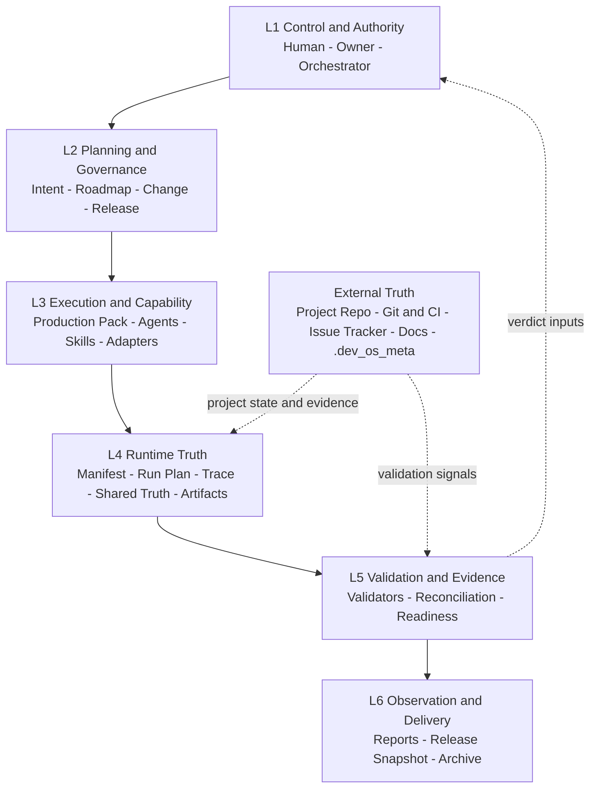
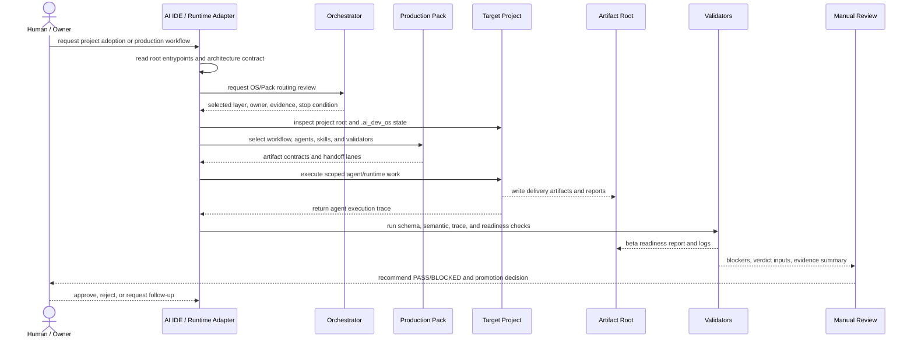

# AI Game Dev OS release archives

## v4.98-beta.1 — 新项目 Beta 开发包（2026-11-18）

面向 macOS 上的全新 Godot 项目。**新用户只需下载这一个 Dev OS ZIP**，无需另外下载 v4.97 或旧版包；Python、Git、Godot 等外部依赖仍需准备。

- [下载 Beta 完整包](https://raw.githubusercontent.com/markjsun1en-sketch/AIGDOS-Releases/main/DevOS-v4.98-beta.1-candidate.zip)（9,880,303 字节，约 9.42 MiB）
- [SHA-256 校验文件](https://raw.githubusercontent.com/markjsun1en-sketch/AIGDOS-Releases/main/DevOS-v4.98-beta.1-candidate.zip.sha256)
- [版本说明与新用户步骤](V498_BETA1_RELEASE_NOTES.md)
- [构建收据](V498_BETA1_BUILD_RECEIPT.json)

解压后从包内 `tools/dev_os_candidate/README.md` 开始，使用 `dev_os.py doctor` 检查依赖，再用 `dev_os.py run-request` 创建包外的全新项目。ZIP 内的顶层目录是 `DevOS-v4.98-beta-integration/`。

构建提交：`e6d09e203980f5f2df0183b794248ca3b261496e`。SHA-256：

```text
491387e002ab37f2db1533e6dc3b38b5854933ddb1833f97ba89f2d57f76fc7d
```

已在 macOS、Python 3.13.2、Godot 4.4 实测新项目执行、正式开发导出及运行、独立审查和 Console 三个页签。本包仍是开发 Beta，未取得完整正式版本资格；OBS65、CAP16 继续阻断，不提供通用旧项目升级。详见版本说明中的能力边界。

## v4.97 — 有限候选开发包（2026-09-14）

v497 有限候选阶段已关闭，包生命周期仍为 draft。完整 L3 / PC-3 和专业效能未通过验收；本次发布不替代 v496 正式验收基线。

- [下载 v497 干净源码 ZIP](AI_Game_Dev_OS_v4.97_Limited_Release.zip)
- [SHA-256 校验](AI_Game_Dev_OS_v4.97_Limited_Release.zip.sha256)
- [v497 版本说明](V497_RELEASE_NOTES.md)
- [构建与验收收据](V497_BUILD_RECEIPT.json)
- [源码标签](https://github.com/markjsun1en-sketch/AIGDOS/tree/v4.97-limited-release/AI_Game_Dev_OS_v4.97)

ZIP 保留精确已提交包的源码、测试、fixture 和兼容镜像，排除本地保管材料、授权确认、原始捕获、IDE 登录及项目运行状态。它是依赖原开发上下文的 developer source package，不是完整专业评测的独立安装包；详见版本说明中的验证范围与限制。

## 历史 v4.93 说明（保留原文）

AI Game Dev OS v4.93

`AI_Game_Dev_OS_v4.93/` is the active v4.93 source tree and this file is the
clean root entrypoint. Layer-local files such as `os_layer/README.md` and
`pack_layer/README.md` are pointers and layer-scope notes; they do not own
v4.93 onboarding, module selection, or invocation instructions.

Start here:

- `INDEX.md` - version-level navigation across root, OS layer, pack layer,
  capability, status, and validation surfaces.
- `MANIFEST.json` - machine-readable manifest for root, layer, pack,
  Orchestrator, evidence, delivery policy, and validation entrypoints.
- `DESIGN_AND_CAPABILITY_ARCHITECTURE.md` - whole-system architecture map,
  founding constraints, truth hierarchy, layer model, and capability flow.
- `MODULES_AND_INVOCATION.md` - authoritative root-level module catalog,
  invocation routes, write boundaries, and command map.
- `RUNTIME_INSTANCE_CONTRACT.md` - target-project `.ai_dev_os/` and artifact
  root contract for generated bindings, run plans, traces, and reports.
- `REAL_PROJECT_ADOPTION_CONTRACT.md` - real-project evidence and lifecycle
  promotion gate.
- `ROOT_MIRROR_POLICY.md` - compatibility decision for root `packs/`,
  `scripts/`, and `tests/` mirrors.
- `IDE_INTEGRATION.md` - bootstrap guide for Codex, WorkBuddy, Cursor, and
  other AI IDE/runtime integrations.
- `USER_MANUAL.md` - user-facing workflow manual for Codex/runtime-adapter use.
- `OS_PACK_LAYER_MAP.md` - boundary map for `os_layer/`, `pack_layer/`, and
  compatibility paths.
- `DELIVERY_CONTRACT.md` - source tree, release snapshot, mirror sync, and
  workspace-governance delivery boundary.
- `CHANGELOG.md` - version history, migration notes, roadmap alignment, and
  provenance details.
- `RESTRUCTURING_PLAN.md` - staged software-engineering plan for adapter
  formalization, runtime instance separation, mirror policy, release refresh,
  and real-project promotion.

## System At A Glance

This is the compact README view of the v4.93 architecture. The authoritative
detailed diagrams and architecture rules live in
`DESIGN_AND_CAPABILITY_ARCHITECTURE.md` inside the release archive.



Authority flows downward from human governance to scoped execution. Runtime
truth and project evidence flow into validation, while lifecycle promotion
returns to human approval. Lower layers may recommend a verdict; they cannot
silently promote the release.

## What This Version Contains

v4.93 is a split-layer AI game development system:

```text
AI_Game_Dev_OS_v4.93/
  os_layer/
  pack_layer/
  adapters/
  schemas/
  packs/      # root compatibility mirror
  scripts/    # root compatibility mirror
  tests/      # root compatibility mirror
```

- `os_layer/` preserves the full v4.92 OS baseline and carries promoted
  OS-layer additions such as the docs-only FixOps foundation. This is packaged
  inside v4.93 as provenance and runtime surface; a complete v4.93 checkout must
  not require an external v4.92 release directory.
- `pack_layer/` carries the v4.93 `end_to_end_production_pack` production pack
  overlay and delivery validation harness.
- `adapters/` carries AI IDE/runtime integration contracts such as the Codex
  adapter policy and invocation profile, plus shared Cursor and WorkBuddy
  runtime adapter contracts.
- `schemas/` carries root contract schemas for the version manifest and AI IDE
  adapter JSON contracts.
- `packs/`, `scripts/`, and `tests/` are compatibility mirrors that keep
  current root-level validation and user commands stable under
  `ROOT_MIRROR_POLICY.md`.

The current package should be read as a Production Pack Beta Candidate
scaffold. It has strong contract and fixture evidence, but it remains
`lifecycle_status: "draft"` until real-project adoption evidence passes review.

The documentation model is root-first. The root directory owns the entrypoint,
module catalog, invocation instructions, delivery rules, and AI IDE bootstrap.
Layer-local README files are pointers only and should not be used as separate
onboarding guides.

## Current Status

- Layer: `game_system_pack`
- Pack id: `end_to_end_production_pack`
- Lifecycle status: `draft`
- Engine support: `godot_2d`, `engine_agnostic`
- Supported phases: `mvp`, `production`
- Main implementation surfaces:
  - `os_layer/`
  - `pack_layer/`
  - `adapters/AI_IDE_ADAPTER_BASE.md`
  - `adapters/codex/`
  - `adapters/cursor/`
  - `adapters/workbuddy_private/`
  - `packs/game_system_packs/end_to_end_production/`
  - `scripts/delivery/`
  - `tests/delivery/`

Current closure surfaces:

- GDD orchestration.
- Shared Truth.
- Architecture Baseline.
- Controlled Small Refactor.
- Agent Harness.
- Beta Readiness.
- FixOps/problem intake.
- OS/Pack resource routing.
- Real-project attachment preflight.
- Real-project adoption contract.

Detailed status lives in the canonical pack-layer path
`pack_layer/packs/game_system_packs/end_to_end_production/docs/roadmap/PHASE_STATUS.md`.
The root mirror path under `packs/` remains a compatibility alias.
Version history and migration notes live in `CHANGELOG.md`.

## Capability Layers

### OS Layer

`os_layer/` provides the inherited full OS baseline:

- control plane and Orchestrator capability sheet;
- agent packs and skill foundations;
- capability protocol schemas;
- runtime, runtime DB, LTM, self-evolution, governance, mount, hub, and profile
  surfaces;
- promoted docs-only FixOps foundation in `os_layer/docs/31_fixops/`.

The OS layer is not the v4.93 total-version entrypoint. Use the root files for
whole-version navigation.

### Pack Layer

`pack_layer/` provides the v4.93 production pack overlay:

- production GDD orchestration;
- specialist GDD authoring and review agents;
- delivery artifact schemas and semantic validation;
- runtime/data/art/QA handoff contracts;
- Shared Truth and Architecture Baseline validators;
- controlled refactor evidence contracts;
- Agent Harness run-plan and execution-trace protocol;
- beta readiness evaluator and report renderer;
- fixture-backed contract tests.

### Compatibility Paths

Root `packs/`, `scripts/`, and `tests/` mirror the current pack-layer
implementation for stable user commands and validation entrypoints. They should
remain aligned with `pack_layer/` until a deliberate migration removes the
compatibility surface. Use `scripts/delivery/validate_pack_layer_mirror.py` to
verify this boundary. `ROOT_MIRROR_POLICY.md` records the current decision to
keep those mirrors as stable public compatibility surfaces for v4.93.

## AI IDE Operating Model

Codex, WorkBuddy, Cursor, or another mounted AI runtime should treat the root
files as the version contract before choosing a layer-local resource. Use this
read order for first contact:

1. `INDEX.md`
2. `MANIFEST.json`
3. `README.md`
4. `DESIGN_AND_CAPABILITY_ARCHITECTURE.md`
5. `MODULES_AND_INVOCATION.md`
6. `RUNTIME_INSTANCE_CONTRACT.md`
7. `REAL_PROJECT_ADOPTION_CONTRACT.md`
8. `ROOT_MIRROR_POLICY.md`
9. `IDE_INTEGRATION.md`
10. `adapters/AI_IDE_ADAPTER_BASE.md`
11. `USER_MANUAL.md`
12. `OS_PACK_LAYER_MAP.md`
13. `os_layer/os_control_plane/leads/orchestrator.capability.json`
14. `pack_layer/packs/game_system_packs/end_to_end_production/capability_pack.json`
15. `pack_layer/packs/game_system_packs/end_to_end_production/references/end_to_end_delivery_workflow.json`
16. `pack_layer/packs/game_system_packs/end_to_end_production/docs/roadmap/PHASE_STATUS.md`

The routing shape is always:

```text
user goal
-> goal class
-> selected layer or workspace governance surface
-> owner agent or control capability
-> owner skill or workflow state
-> allowed write surfaces
-> required evidence
-> validation command
-> stop condition
```

### Real-Project Adoption Flow

The following sequence shows the complete handoff across human authority, the
AI IDE or runtime adapter, OS routing, pack execution, project state, evidence,
validation, and manual review.



Real-project adoption remains blocked until project runtime state, delivery
artifacts, a runtime-produced execution trace, validation logs, a readiness
report, and manual review are present.

Repository Python scripts may generate plans, contracts, reports, and
validators. They do not become an automatic LLM router and do not silently
execute agents. External runtimes consume the generated contracts, execute the
human/agent work, then return evidence such as `agent_execution_trace.json` for
validation.

AI IDE-specific adapter contracts live under `adapters/`. All adapters inherit
the shared base in `adapters/AI_IDE_ADAPTER_BASE.md`. Codex, Cursor, and
WorkBuddy have sibling adapter directories that specialize runtime behavior
without redefining canonical agents, skills, workflows, schemas, or validators.

Generated runtime state belongs in the target project or an explicit artifact
root, not in canonical v4.93 definitions. `RUNTIME_INSTANCE_CONTRACT.md`
defines the required separation between `AI_Game_Dev_OS_v4.93/`,
`target_project/.ai_dev_os/`, `target_project_artifacts/v493/`, and
repository-root `.dev_os_meta/`.

## `.dev_os_meta` Delivery Policy

The repository-root `.dev_os_meta/` directory is workspace governance state. It
is not part of the `AI_Game_Dev_OS_v4.93/` runtime package by default.

For delivery:

- exclude `.dev_os_meta/` from the version payload unless the delivery contract
  explicitly asks for workspace governance evidence;
- include `.dev_os_meta` references in manifests or reports as evidence
  pointers, not as executable package inputs;
- package accepted OS behavior only after promotion into `os_layer/`;
- package accepted production-pack behavior only after promotion into
  `pack_layer/` or the root compatibility mirrors;
- deliver raw Problem/Fix/Pattern/Self-Evo cards as a separate governance
  appendix when reviewers need provenance;
- never make runtime startup, pack validation, or agent routing depend on
  `.dev_os_meta/` being present.

## Primary Pack Resources

The root module and command map lives in `MODULES_AND_INVOCATION.md`. The files
below are implementation resources selected by that root-level contract.

- `pack_layer/packs/game_system_packs/end_to_end_production/capability_pack.json`
  - pack manifest, lifecycle status, dependency packs, agents, skills,
  allowed writes, forbidden writes, and validation commands.
- `pack_layer/packs/game_system_packs/end_to_end_production/references/end_to_end_delivery_workflow.json`
  - skill ownership, artifact routes, and workflow closure rules.
- `pack_layer/packs/game_system_packs/end_to_end_production/docs/agent_harness/RUNTIME_ADAPTER_SPEC.md`
  - external runtime adapter contract for consuming run plans and producing
  execution traces.
- `pack_layer/packs/game_system_packs/end_to_end_production/docs/beta/REAL_PROJECT_ADOPTION_CHECKLIST.md`
  - required real-project evidence before beta promotion.
- `pack_layer/packs/game_system_packs/end_to_end_production/docs/roadmap/PHASE_STATUS.md`
  - current completion state and remaining promotion prerequisites.

Primary local agents:

- `gdd_production_author`
- `gdd_creative_director`
- `gdd_module_author`
- `gameplay_systems_designer`
- `balance_economy_designer`
- `content_progression_designer`
- `gdd_review_steward`
- `game_researcher`
- `approval_gate_steward`
- `playtest_session_recorder`
- `playtest_design_synthesizer`
- `rawdata_chain_executor`
- `godot_runtime_slice_engineer`
- `ui_asset_runtime_binder`
- `focused_qa_evidence_runner`
- `visual_stop_steward`
- `delivery_readiness_runner`

## Minimal Workflows

### Start A GDD Run

```bash
python3 AI_Game_Dev_OS_v4.93/scripts/delivery/run_gdd_orchestrator.py start \
  --intent "反向塔防：护送怪物下班"
```

This writes a planned run package, not the final authored GDD prose. A runtime
adapter or AI IDE must read the generated agent brief, execute the owner agents,
and return artifacts for validation.

Validate the run package or completed outputs:

```bash
python3 AI_Game_Dev_OS_v4.93/scripts/delivery/run_gdd_orchestrator.py validate \
  --artifact-root <artifact_root>
```

### Attach A Real Project

```bash
python3 AI_Game_Dev_OS_v4.93/scripts/delivery/evaluate_pack_beta_readiness.py \
  --project-root <project_root> \
  --artifact-root <delivery_artifact_root> \
  --dry-run \
  --write-report /tmp/v493_beta_readiness_dry_run.json
```

A first real-project dry run may be `BLOCKED`. Treat blockers as routing input,
not as proof that the OS failed.

### Use An External Agent Runtime

```bash
python3 AI_Game_Dev_OS_v4.93/scripts/delivery/generate_agent_run_plan.py \
  --artifact-root <delivery_artifact_root> \
  --write-plan /tmp/v493_agent_run_plan.json
```

The runtime adapter consumes the plan and returns an `agent_execution_trace.json`.
Validate it with:

```bash
python3 AI_Game_Dev_OS_v4.93/scripts/delivery/validate_agent_execution_trace.py \
  --run-plan /tmp/v493_agent_run_plan.json \
  --trace <agent_execution_trace.json>
```

Only runtime-produced traces can support beta promotion. Sample traces are
regression evidence only.

## Validation

Root compatibility contract tests:

```bash
python3 -m pytest AI_Game_Dev_OS_v4.93/tests/delivery/test_v493_end_to_end_skill_contracts.py -q --tb=short
```

Pack-layer mirror contract tests:

```bash
python3 -m pytest AI_Game_Dev_OS_v4.93/pack_layer/tests/delivery/test_v493_end_to_end_skill_contracts.py -q --tb=short
```

OS-layer boundary docs test:

```bash
python3 -m pytest AI_Game_Dev_OS_v4.93/os_layer/tests/test_v493_layer_boundary_docs.py -q --tb=short
```

Markdown path checks:

```bash
python3 AI_Game_Dev_OS_v4.93/scripts/delivery/validate_markdown_local_paths.py
python3 AI_Game_Dev_OS_v4.93/pack_layer/scripts/delivery/validate_markdown_local_paths.py
```

Mirror sync check:

```bash
python3 AI_Game_Dev_OS_v4.93/scripts/delivery/validate_pack_layer_mirror.py
```

Release snapshot freshness diagnosis:

```bash
python3 AI_Game_Dev_OS_v4.93/scripts/delivery/validate_release_snapshot_freshness.py --strict
```

Transient file diagnosis:

```bash
python3 AI_Game_Dev_OS_v4.93/scripts/delivery/validate_delivery_transients.py --strict
```

Patch hygiene:

```bash
git diff --check -- AI_Game_Dev_OS_v4.93
```

## Boundaries

- Do not treat `os_layer/README.md` as the full v4.93 version README.
- Do not treat `pack_layer/README.md` as the full v4.93 version README.
- Do not auto-call LLM agents from repository scripts.
- Do not promote `lifecycle_status` from `draft` without real-project beta
  readiness evidence and a reviewed runtime-produced agent trace.
- Do not make repository-root `.dev_os_meta/` runtime package content.
- Do not treat fixture-only success as real-project adoption evidence.
- Do not commit generated exploratory GDD outputs unless they are intentional
  regression fixtures.
