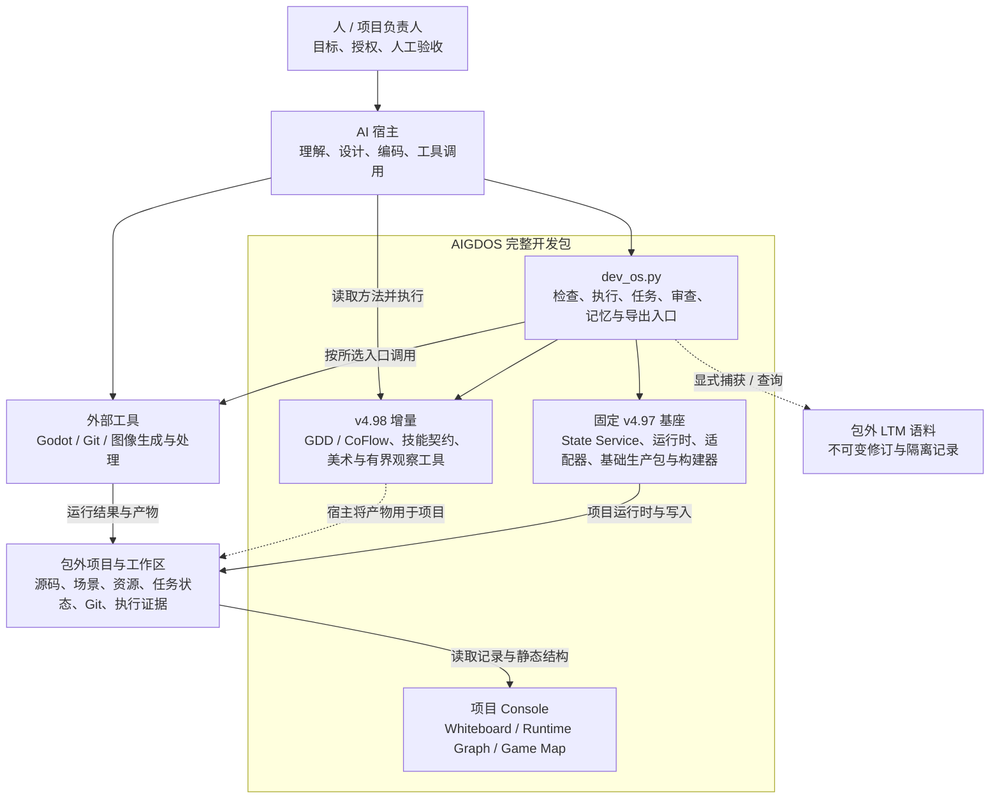

# AIGDOS — AI Game Dev OS

**中文** | [English](README.en.md)

**AIGDOS 是一套配合 AI 编程助手使用的游戏开发工作框架。** 它把游戏想法、设计文档、任务、代码与资源、测试证据、独立审查和人工验收连接起来，让开发过程可以继续推进、追溯和检查。

这里是 AIGDOS 的公开分发仓库。当前公开开发包为 **v4.98-beta.1**，面向 **macOS 上的全新 Godot 项目**，发布于 2026-11-18。

[下载完整 Beta 包](https://raw.githubusercontent.com/markjsun1en-sketch/AIGDOS-Releases/main/DevOS-v4.98-beta.1-candidate.zip) · [新用户指南](V498_BETA1_QUICKSTART.md) · [完整能力说明](AIGDOS_CAPABILITIES.md) · [版本说明](V498_BETA1_RELEASE_NOTES.md) · [构建收据](V498_BETA1_BUILD_RECEIPT.json)

## AIGDOS 用来做什么

开发一个游戏时，AI 需要知道“现在做什么、依据哪个设计、可以改哪里、怎样证明完成”。AIGDOS 为这些问题提供项目约定、专业工作方法、结构化交付格式、命令行工具和本地 Console。

例如，你要为 Godot 游戏增加一个蓄力条，可以用它组织需求与验收条件，限定代码修改范围，执行导入和行为检查，保存实际源码提交与证据，再交给独立审查人和你本人确认。包内 `charge_meter.json` 展示了这一执行链；更大的游戏仍要由人和 AI 宿主分解、实现和验证。

适合希望与 AI 长期协作的独立开发者、小团队、游戏策划和技术负责人，也适合需要检查任务进度与交付依据的项目负责人。

名称中的 **OS** 指开发工作体系。AIGDOS 运行在你的操作系统和 AI 宿主之上：Godot 运行游戏，AI 宿主负责理解、创作、编码与调用工具，AIGDOS 提供工作约束、状态与验证入口。模型、引擎和图像生成服务需要另行准备。

## Dev OS 架构



箭头表示调用或数据关系，不授予权限，也不表示所有模块自动运行。固定基座提供任务运行时，v4.98 增量补充方法与工具；项目状态和用户记忆保存在包外。Console 展示记录，任务关闭和人工接受仍由原入口分别办理。交付中的检查、独立审查与接受关系见[能力说明中的流程图](AIGDOS_CAPABILITIES.md#交付流程)。

## 能力概览

| 开发环节 | 可以用它做什么 | 使用条件与边界 |
| --- | --- | --- |
| 游戏想法与 GDD | 分阶段整理概念、世界、机制、模式、数值、UI、资源和评审；维护模块、设计事实、依赖与变更 | 提供工作方法、契约和校验器；内容由宿主与人完成 |
| 任务与协作 | 记录任务、进度、交接、实现提交和独立审查；区分声明完成与实际接受 | 运行时管理状态；角色身份与执行由宿主提供 |
| Godot 开发 | 按限定功能切片组织脚本、场景、资源和行为检查；示例可在全新目录实际执行 | 当前 Beta 实测 macOS / Godot 4.4 的限定新项目链路 |
| 数值与数据 | 组织数值模型、RawData 到运行时数据链、正式文本链及相应验证 | 需要项目真实的数据格式、工具绑定和验收条件 |
| 美术与 UI | 场景/氛围/概念稿工作流、局部修图、已有素材图层提取与组合预览、资源接受与运行时绑定 | 图像生成由外部工具执行；视觉质量和运行时效果另行验收 |
| QA 与开发交付 | 保存定向测试证据，准备 macOS 导出，核对 PCK 原始字节，并走正式开发构建与审查 | PCK 校验通过不等于玩法、签名、窗口交互全部通过 |
| 本地项目 Console | Whiteboard 查看任务；Runtime Graph 查看关系；Game Map 查看 Godot 场景和脚本结构 | Game Map 读取静态声明；页面状态不能替代验收 |
| 记忆与复用 | 在包外保存有证据的经验修订、查询记忆、检查与试查候选索引 | 缺少证据/批准的记录隔离；不会自动吸收为已接受知识 |
| 可追溯与诊断 | 核对产物、来源、上下文引用、任务时间、显式用量记录及有界恢复材料 | 缺测保持未知；诊断记录不自动授予完成或发布资格 |

当前生产包列出 **53 项公开技能**，完整清单、各项用途、负责人和进阶模块见[能力说明](AIGDOS_CAPABILITIES.md)。这些是可供宿主执行的技能定义；技能数量不代表自动代理进程数量，也不代表逐项实战验收数量。

## 下载与校验

新用户只需下载下面这一个 Dev OS ZIP，已包含固定 v4.97 基座、v4.98 增量和配套工具。无需另装旧版 Dev OS。

- [DevOS-v4.98-beta.1-candidate.zip](https://raw.githubusercontent.com/markjsun1en-sketch/AIGDOS-Releases/main/DevOS-v4.98-beta.1-candidate.zip) — 9,880,303 字节，约 9.42 MiB。
- [SHA-256 校验文件](https://raw.githubusercontent.com/markjsun1en-sketch/AIGDOS-Releases/main/DevOS-v4.98-beta.1-candidate.zip.sha256)。

```text
491387e002ab37f2db1533e6dc3b38b5854933ddb1833f97ba89f2d57f76fc7d
```

构建源码提交：`e6d09e203980f5f2df0183b794248ca3b261496e`。ZIP 顶层目录为 `DevOS-v4.98-beta-integration/`。这是已发布的原包，文档更新不改变包内字节。SHA-256 用来核对字节一致性，发布身份详见[构建收据](V498_BETA1_BUILD_RECEIPT.json)。

## 第一次使用

给新用户介绍或转发时，可以直接分享[新用户介绍与上手指南](V498_BETA1_QUICKSTART.md)，其中包含用途、下载、校验、执行步骤和 Beta 边界。

必要环境：macOS、Python 3.10+、Git、Godot 4.4。实际验证使用 Python 3.13.2；其他 Python 版本未逐版验证。把 ZIP 与校验文件放在同一目录，确保下面的解压目录、虚拟环境和项目目录尚不存在。

```sh
# 校验必须显示 OK；失败时停止，重新核对下载文件
shasum -a 256 -c DevOS-v4.98-beta.1-candidate.zip.sha256
unzip DevOS-v4.98-beta.1-candidate.zip
cd DevOS-v4.98-beta-integration

python3 -m venv ../devos-beta-venv
. ../devos-beta-venv/bin/activate
python3 -m pip install -r tools/dev_os_candidate/requirements.txt

# 检查包与 Godot 开发依赖
python3 -B dev_os.py doctor --profile godot

# 在包外全新目录运行自带蓄力条示例
python3 -B dev_os.py run-request \
  --request tools/dev_os_candidate/examples/charge_meter.json \
  --workspace "$PWD/../new-game-run"
```

若自动探测不到 Godot，向 `doctor` 和 `run-request` 都添加 `--godot /你的/Godot/可执行文件路径`。macOS 的常见路径是 `/Applications/Godot.app/Contents/MacOS/Godot`。

成功后，`new-game-run/project/` 存放项目和项目指令，`new-game-run/evidence/` 存放执行证据及审查交接。该命令会在新项目创建本地 Git 提交，结束状态为 **`CLAIMED_DONE`（已声明完成、待独立审查）**。独立审查与白板人工验收仍需分别办理。

`run-request` 执行请求 JSON 中由调用者提供的源码。开始自己的游戏时，应先让 AI 宿主与你确定需求、编写并审阅请求和源码，再执行。它不内置模型，执行目录也不构成操作系统沙箱。

完整操作见包内 `tools/dev_os_candidate/README.md` 与[版本说明](V498_BETA1_RELEASE_NOTES.md)。查看技能及职责可以运行：

```sh
python3 -B dev_os.py capabilities
python3 -B dev_os.py capabilities --skill godot_runtime_feature_slice_skill
```

## Beta 已验证到哪里

同一构建已在限定的 macOS 新项目中验证 Godot 导入、玩法检查、两次内容一致的正式开发导出、本机签名核验、隔离 PCK 恢复、导出程序运行与窗口操作，并完成相关任务的独立审查。Console 三个页签、同页刷新及白板保存和重启读回也已有实测。

**OBS65、CAP16 继续阻断；本包尚未获得完整正式版本资格。** 全部专业能力的实际效果、Windows/Linux、跨机器复现、通用旧项目升级与完整备份恢复没有由本次 Beta 证明。新项目示例成功也不能直接作为你自己的游戏已通过验收的依据。详细条件见[能力说明](AIGDOS_CAPABILITIES.md)和[版本说明](V498_BETA1_RELEASE_NOTES.md)。

## 历史版本与资料

| 版本 | 下载与资料 | 原有定位 |
| --- | --- | --- |
| v4.97 | [源码 ZIP](AI_Game_Dev_OS_v4.97_Limited_Release.zip) · [校验](AI_Game_Dev_OS_v4.97_Limited_Release.zip.sha256) · [版本说明](V497_RELEASE_NOTES.md) · [收据](V497_BUILD_RECEIPT.json) | 有限候选阶段已关闭，包生命周期仍为 draft；不替代 v4.96 正式验收基线 |
| v4.93 | [历史首页原文](V493_README.md) · [历史用户手册](USER_MANUAL.md) | 保留历史架构与操作说明，不作为当前 Beta 的安装入口 |

v4.97 旧包依赖原开发上下文，属于 developer source package。当前新用户请从上面的 v4.98-beta.1 完整包开始。
